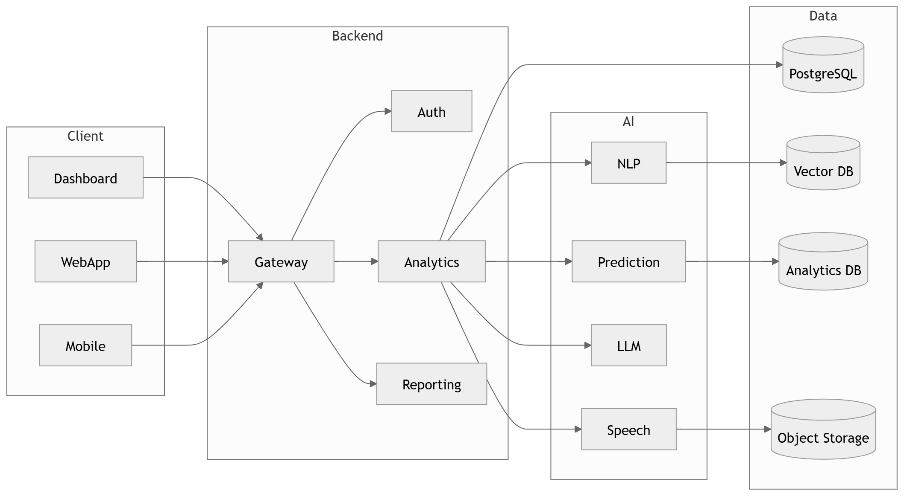

# AI Conversation Intelligence Platform — Architecture Repository

> Enterprise architecture documentation for an AI call-center
> **conversation-intelligence** platform: audio → speech → diarization →
> emotion → NLP → LLM → QA & compliance → prediction → analytics, delivered
> through role-based dashboards.

<p align="center">
  
</p>

[](mkdocs.yml)
[](docs/architecture_index.md)
[](LICENSE)

---

## Table of contents

- [Project overview](#project-overview)
- [Architecture overview](#architecture-overview)
- [Repository structure](#repository-structure)
- [Technology stack](#technology-stack)
- [Architecture principles](#architecture-principles)
- [Diagram index](#diagram-index)
- [Documentation guide](#documentation-guide)
- [Getting started](#getting-started)
- [Contributing](#contributing)
- [License](#license)

## Project overview

The platform ingests live and recorded contact-center conversations and turns
them into compliance-grade, predictive, actionable intelligence. This repository
is the **single source of truth** for its architecture: **59
diagrams** with full documentation, cross-references, an MkDocs website and
validation tooling.

> The diagrams are authoritative. The tooling in `scripts/` only organizes,
> documents, cross-references and validates them — it never redesigns them.

## Architecture overview

| Section | Diagrams | Location | Summary |
|---|---|---|---|
| **System Overview** | 10 | `diagrams/png/01_System_Overview/` | Context, container and service-level views of the platform (C4-style) plus the end-to-end call and data flows. |
| **AI Pipeline** | 20 | `diagrams/png/02_AI_Pipeline/` | The conversation-intelligence AI stack: audio, ASR, diarization, emotion, NLP, LLM orchestration, QA, prediction, coaching and decisioning. |
| **Data Architecture** | 10 | `diagrams/png/03_Data_Architecture/` | Operational, analytical, vector, feature-store, object and cache storage tiers and the data lifecycle that binds them. |
| **Backend & API** | 10 | `diagrams/png/04_Backend/` | API gateway, request lifecycles, event-driven services, service dependencies, authentication and RBAC. |
| **Product & Program Views** | 9 | `diagrams/png/05_Product/` | Program-level boards spanning dashboards, AI models, ML/MLOps, operations, documentation, infrastructure, security and product features. |

Read the narrative starting at [docs/index.md](docs/index.md) or jump to the
[Diagram Index](docs/architecture_index.md).

## Repository structure

```
AI-Conversation-Intelligence-Architecture/
├── README.md  LICENSE  CHANGELOG.md  CONTRIBUTING.md
├── mkdocs.yml  requirements.txt
├── docs/                 # Markdown documentation (MkDocs site source)
│   ├── index.md  architecture_index.md  glossary.md  references.md
│   ├── 01-executive-summary.md … 05-nonfunctional-architecture.md
│   ├── ai/ backend/ database/ dashboard/ deployment/ security/ product/
│   ├── diagrams/         # one page per diagram
│   └── assets/img/       # in-docs image mirror (rendered by MkDocs & GitHub)
├── diagrams/
│   ├── png/              # source-of-truth diagram exports (5 sections)
│   ├── svg/ pdf/ thumbnails/
├── source/               # mermaid / drawio / plantuml sources (if any)
├── assets/ templates/ output/ tests/ logs/
├── scripts/              # generation + validation tooling
└── .github/workflows/    # build · validate · deploy
```

## Technology stack

| Layer | Technology (representative) |
|---|---|
| Audio / ASR | DSP, VAD, speech-recognition & diarization models |
| NLP | Intent, sentiment, topic, NER, keyword models |
| LLM | LLM orchestration with RAG + guardrails |
| Data | Relational DB · analytics warehouse · vector DB · feature store · object store · cache |
| Backend | API gateway · event-driven microservices · auth/RBAC |
| Presentation | Role-based dashboard SPA |
| Platform | Containers · Kubernetes · cloud infrastructure |
| Docs | MkDocs Material · Mermaid · Python tooling |

## Architecture principles

1. **Diagrams are the source of truth** — documentation is generated from them.
2. **C4 decomposition** — context → container → component → sequence.
3. **Separation of concerns** — clear layer and service boundaries.
4. **Event-driven where it counts** — async decoupling for scale and resilience.
5. **Security & compliance by design** — edge auth, RBAC, encryption, retention.
6. **Everything is navigable** — every page has previous/next/related links.

## Diagram index

See **[docs/architecture_index.md](docs/architecture_index.md)** for the full,
linked catalogue of all 59 diagrams with purpose and
cross-references.

## Documentation guide

- **Narrative path:** [Executive Summary](docs/01-executive-summary.md) →
  [System Overview](docs/03-system-overview.md) →
  [Functional](docs/04-functional-architecture.md) →
  [Non-Functional](docs/05-nonfunctional-architecture.md).
- **By domain:** [AI](docs/ai/overview.md) · [Backend](docs/backend/overview.md)
  · [Data](docs/database/overview.md) · [Dashboards](docs/dashboard/executive.md)
  · [Deployment](docs/deployment/infrastructure.md) ·
  [Security](docs/security/authentication.md).
- **Per diagram:** `docs/diagrams/<section>/<NN>_<name>.md`.

## Getting started

```bash
# 1. Install tooling
pip install -r requirements.txt

# 2. (Re)build the repository from the source diagrams
python scripts/generator.py

# 3. Validate links, images and naming
python scripts/validate.py

# 4. Preview the documentation website
mkdocs serve         # http://127.0.0.1:8000
```

## Contributing

See [CONTRIBUTING.md](CONTRIBUTING.md). In short: change the diagram, update its
catalog metadata, re-run `python scripts/generator.py`, then `validate.py`.

## License

[MIT](LICENSE) © 2026.
