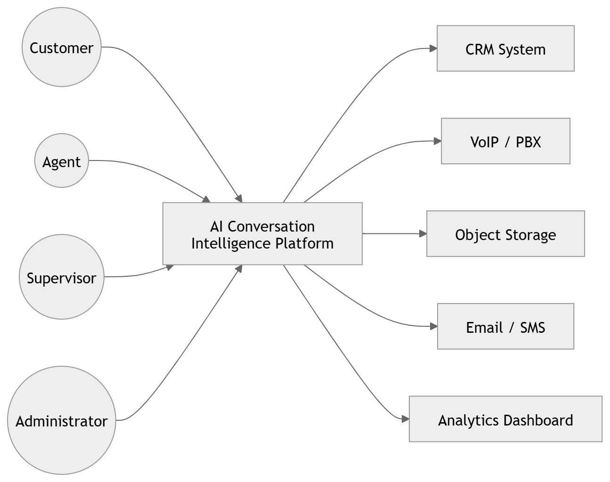
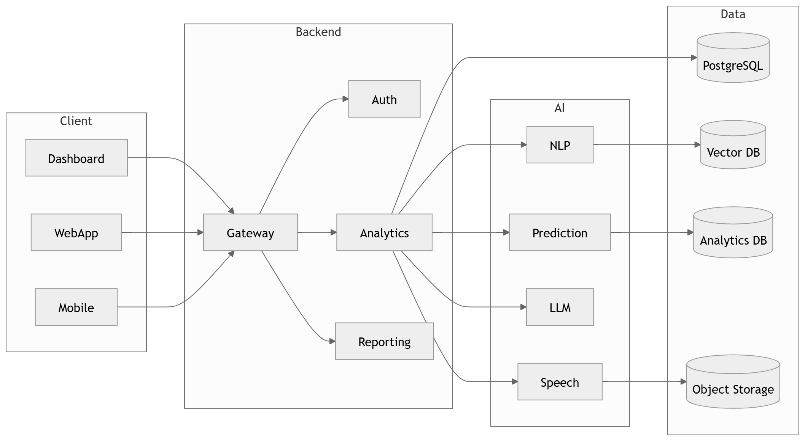
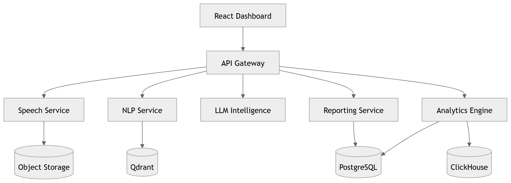
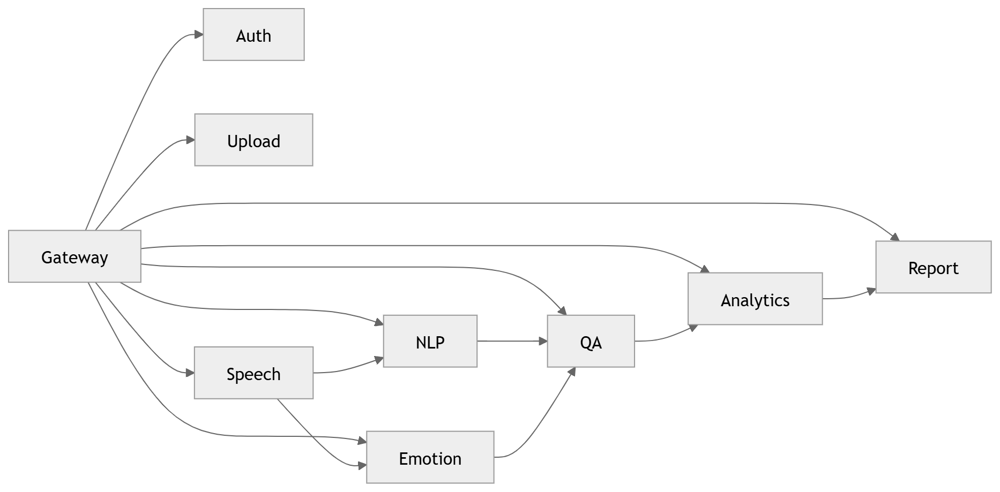
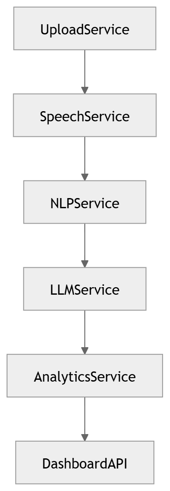
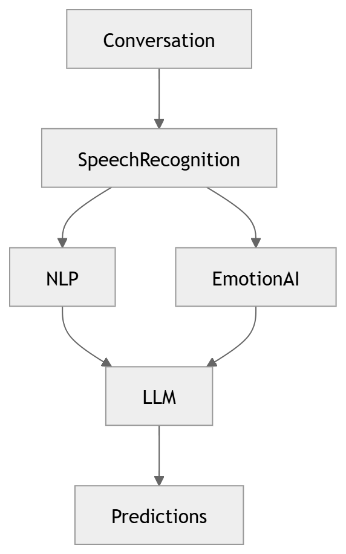
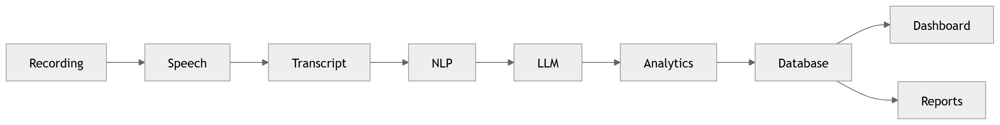

# System Overview

Context, container and service-level views of the platform (C4-style) plus the end-to-end call and data flows.

These diagrams follow the C4 model (context → container → component) and then
trace the call and data flows end to end.

### 01 · [System Context Diagram](diagrams/01_System_Overview/01_System_Context_Diagram.md)

Establish the system boundary and external actors.

### 02 · [High Level Architecture](diagrams/01_System_Overview/02_High_Level_Architecture.md)

Show the major layers and how they compose end to end.

### 03 · [Container Diagram](diagrams/01_System_Overview/03_Container_Diagram.md)

C4 Level-2 container decomposition.

### 04 · [Microservice Dependency](diagrams/01_System_Overview/04_Microservice_Dependency.md)

Map dependencies between microservices.

### 05 · [Service Communication](diagrams/01_System_Overview/05_Service_Communication.md)

Define inter-service communication patterns.

### 06 · [Call Processing Overview](diagrams/01_System_Overview/06_Call_Processing_Overview.md)

Summarize the lifecycle of a single call.

### 07 · [AI Service Architecture](diagrams/01_System_Overview/07_AI_Service_Architecture.md)

Architecture of the AI service plane.

### 08 · [Dashboard Modules](diagrams/01_System_Overview/08_Dashboard_Modules.md)

Catalogue the dashboard modules.

### 09 · [Analytics Architecture](diagrams/01_System_Overview/09_Analytics_Architecture.md)

Analytics platform architecture.

### 10 · [Overall Data Flow](diagrams/01_System_Overview/10_Overall_Data_Flow.md)

Overall data flow across the platform.

---

[⬅ Business Overview](02-business-overview.md) &nbsp;|&nbsp; [➡ Functional Architecture](04-functional-architecture.md)
