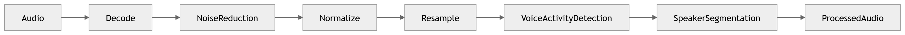

# Audio Processing

Conditioning raw call audio for downstream recognition.

### 12 · [Audio Processing](../diagrams/02_AI_Pipeline/12_Audio_Processing.md)

Audio pre-processing stage.

### 14 · [Speaker Diarization](../diagrams/02_AI_Pipeline/14_Speaker_Diarization.md)

Speaker diarization.

---

[⬆ Diagram Index](../architecture_index.md) &nbsp;|&nbsp; [🏠 Home](../index.md)
