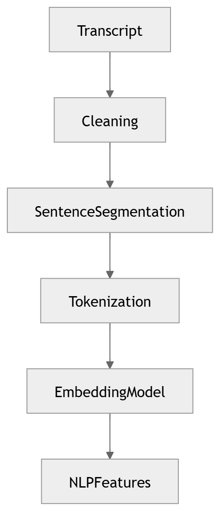
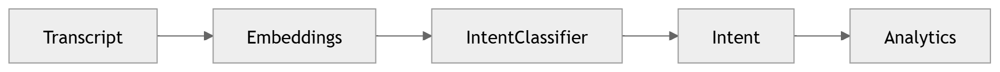
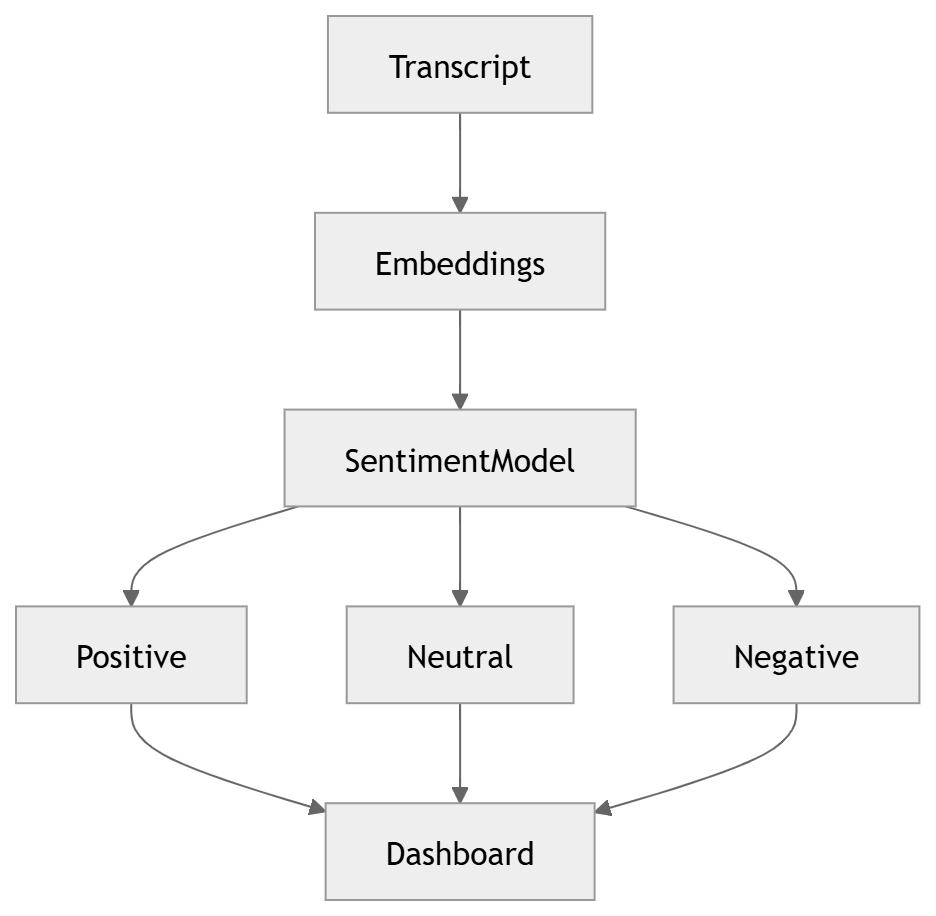
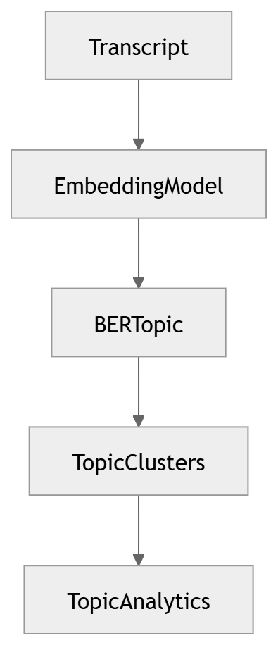
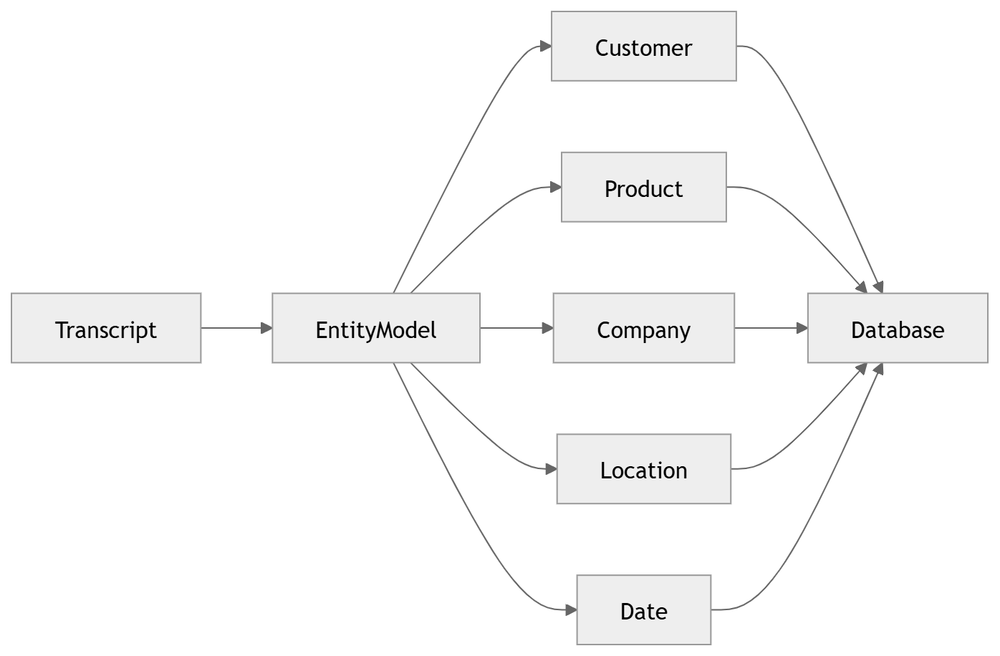
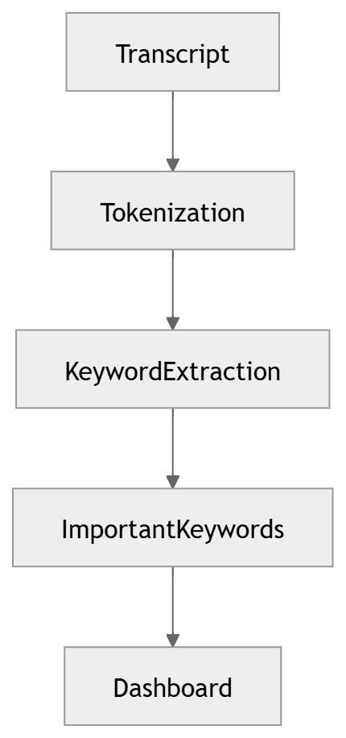

# Natural Language Processing

The linguistic layer: intent, sentiment, topics, entities, keywords.

### 16 · [NLP Pipeline](../diagrams/02_AI_Pipeline/16_NLP_Pipeline.md)

Core NLP processing.

### 17 · [Intent Detection](../diagrams/02_AI_Pipeline/17_Intent_Detection.md)

Intent detection.

### 18 · [Sentiment Analysis](../diagrams/02_AI_Pipeline/18_Sentiment_Analysis.md)

Sentiment analysis.

### 19 · [Topic Modeling](../diagrams/02_AI_Pipeline/19_Topic_Modeling.md)

Topic modelling.

### 20 · [Named Entity Recognition](../diagrams/02_AI_Pipeline/20_Named_Entity_Recognition.md)

Named-entity recognition.

### 21 · [Keyword Extraction](../diagrams/02_AI_Pipeline/21_Keyword_Extraction.md)

Keyword / keyphrase extraction.

---

[⬆ Diagram Index](../architecture_index.md) &nbsp;|&nbsp; [🏠 Home](../index.md)
