# AI Architecture

The conversation-intelligence AI stack. Each stage below links to its diagram and a topic page.

## Topic pages

- [Audio Processing](audio-processing.md)
- [Speech Recognition](speech-recognition.md)
- [NLP](nlp.md)
- [LLM Intelligence](llm.md)
- [Prediction](prediction.md)
- [Coaching](coaching.md)
- [Analytics](analytics.md)

## All diagrams in this section

### 11 · [End to End AI Pipeline](../diagrams/02_AI_Pipeline/11_End_to_End_AI_Pipeline.md)

End-to-end AI processing pipeline.

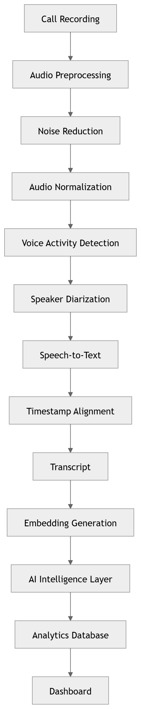

### 12 · [Audio Processing](../diagrams/02_AI_Pipeline/12_Audio_Processing.md)

Audio pre-processing stage.

### 13 · [Speech Recognition](../diagrams/02_AI_Pipeline/13_Speech_Recognition.md)

Automatic speech recognition.

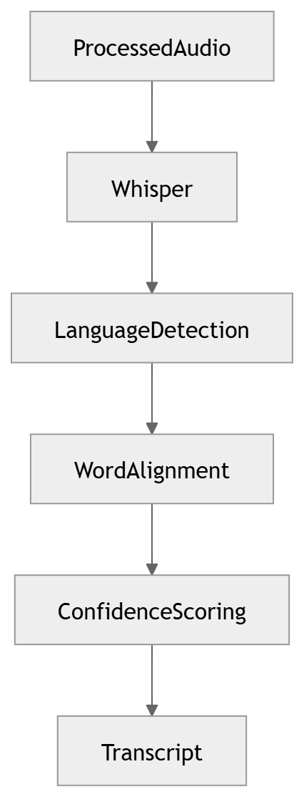

### 14 · [Speaker Diarization](../diagrams/02_AI_Pipeline/14_Speaker_Diarization.md)

Speaker diarization.

### 15 · [Emotion Recognition](../diagrams/02_AI_Pipeline/15_Emotion_Recognition.md)

Emotion / affect recognition.

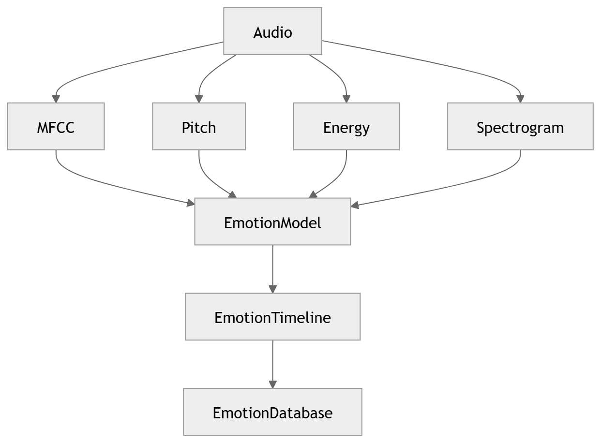

### 16 · [NLP Pipeline](../diagrams/02_AI_Pipeline/16_NLP_Pipeline.md)

Core NLP processing.

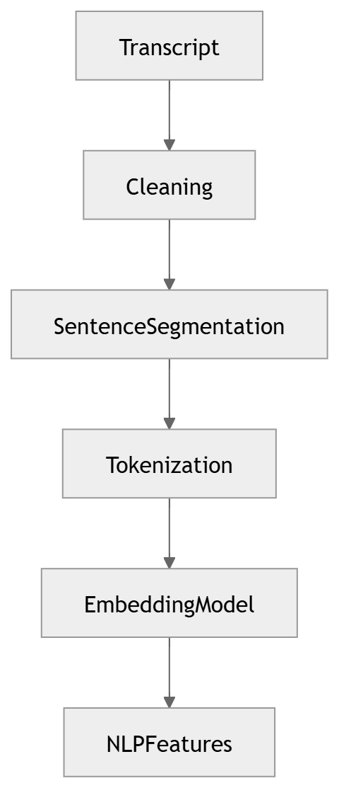

### 17 · [Intent Detection](../diagrams/02_AI_Pipeline/17_Intent_Detection.md)

Intent detection.

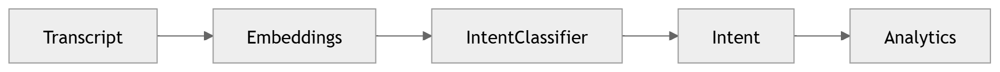

### 18 · [Sentiment Analysis](../diagrams/02_AI_Pipeline/18_Sentiment_Analysis.md)

Sentiment analysis.

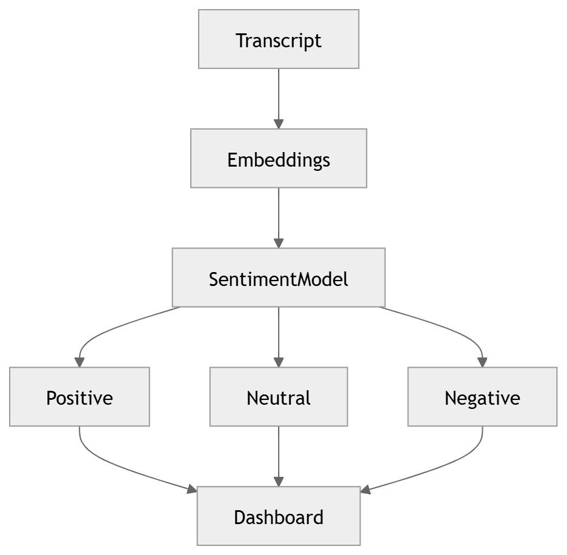

### 19 · [Topic Modeling](../diagrams/02_AI_Pipeline/19_Topic_Modeling.md)

Topic modelling.

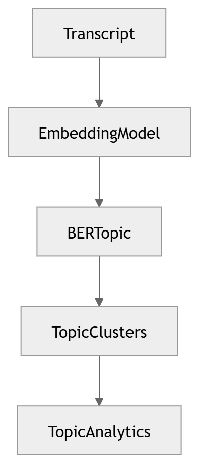

### 20 · [Named Entity Recognition](../diagrams/02_AI_Pipeline/20_Named_Entity_Recognition.md)

Named-entity recognition.

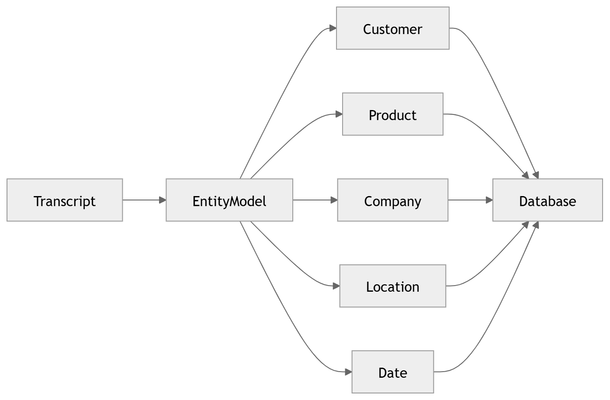

### 21 · [Keyword Extraction](../diagrams/02_AI_Pipeline/21_Keyword_Extraction.md)

Keyword / keyphrase extraction.

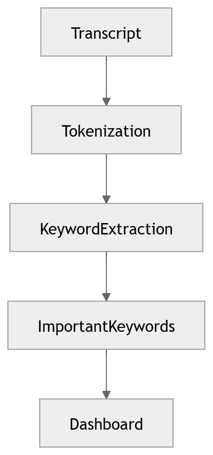

### 22 · [Conversation Intelligence](../diagrams/02_AI_Pipeline/22_Conversation_Intelligence.md)

Conversation intelligence fusion.

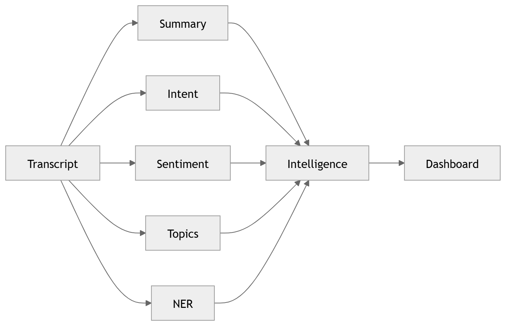

### 23 · [LLM Orchestration](../diagrams/02_AI_Pipeline/23_LLM_Orchestration.md)

LLM orchestration.

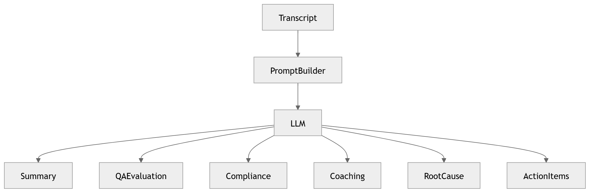

### 24 · [QA Evaluation](../diagrams/02_AI_Pipeline/24_QA_Evaluation.md)

QA evaluation & compliance scoring.

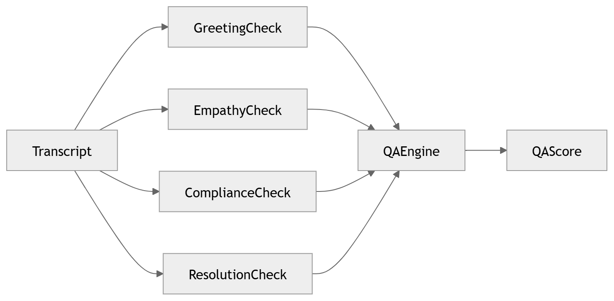

### 25 · [Business Intelligence](../diagrams/02_AI_Pipeline/25_Business_Intelligence.md)

Business intelligence pipeline.

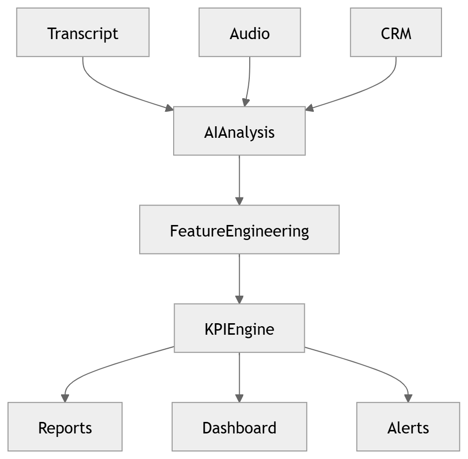

### 26 · [Prediction Engine](../diagrams/02_AI_Pipeline/26_Prediction_Engine.md)

Prediction engine.

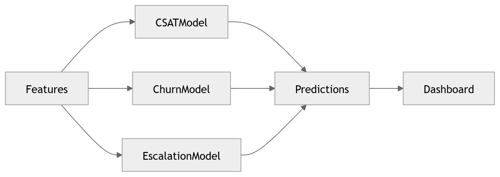

### 27 · [Coaching Recommendation](../diagrams/02_AI_Pipeline/27_Coaching_Recommendation.md)

Coaching recommendation engine.

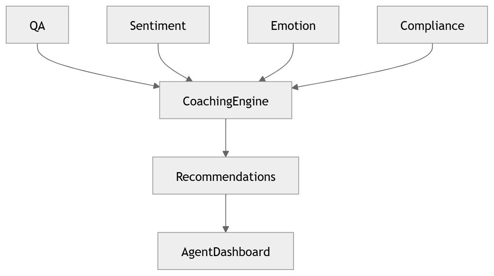

### 28 · [Analytics Aggregation](../diagrams/02_AI_Pipeline/28_Analytics_Aggregation.md)

Analytics aggregation.

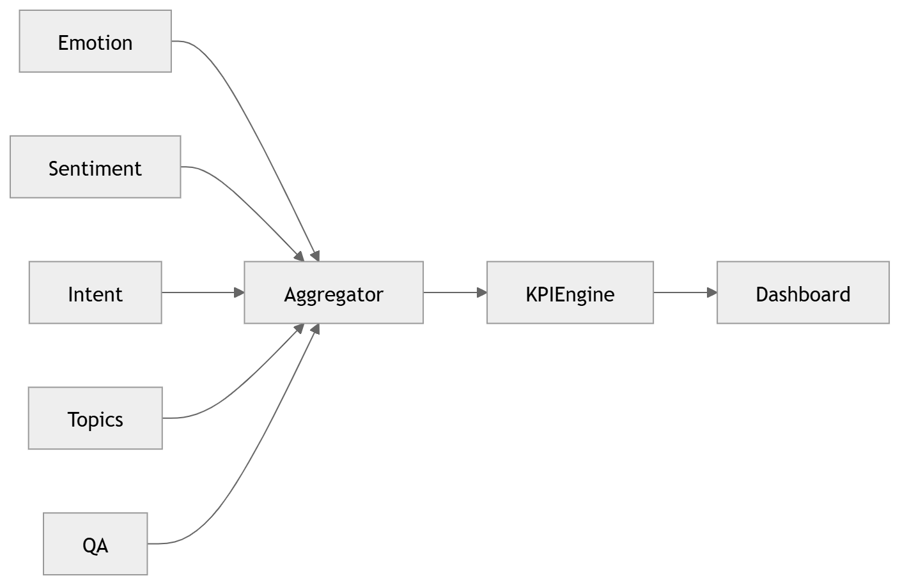

### 29 · [AI Decision Engine](../diagrams/02_AI_Pipeline/29_AI_Decision_Engine.md)

AI decision engine.

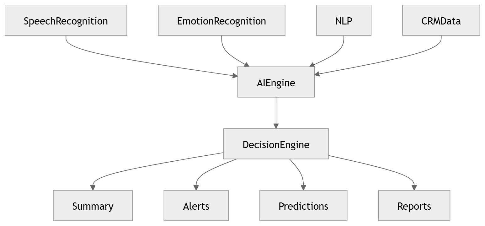

### 30 · [Complete AI Pipeline](../diagrams/02_AI_Pipeline/30_Complete_AI_Pipeline.md)

Complete AI pipeline (consolidated).

---

[⬆ Diagram Index](../architecture_index.md) &nbsp;|&nbsp; [🏠 Home](../index.md)
