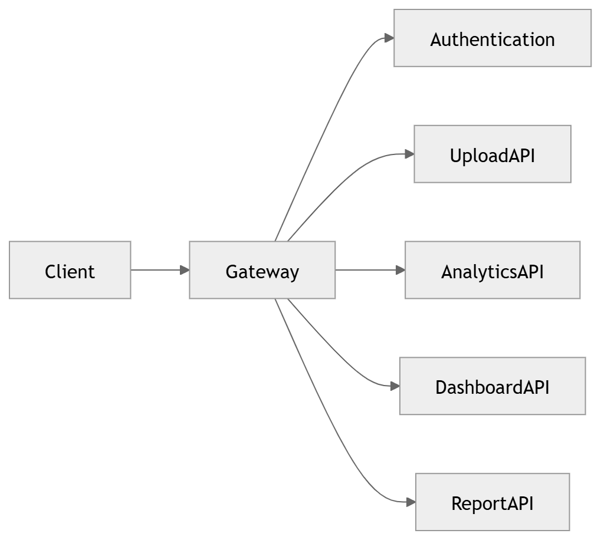
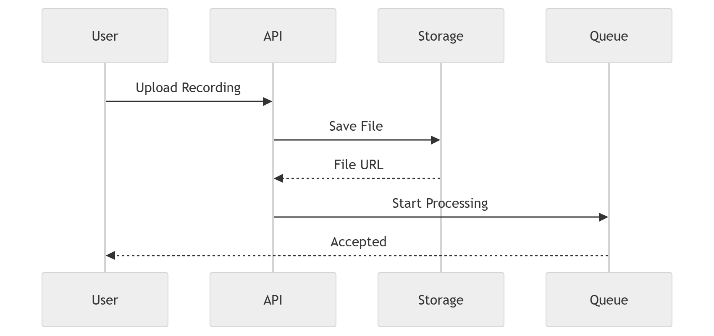

# API

The API gateway and ingestion surface of the platform.

### 41 · [API Gateway](../diagrams/04_Backend/41_API_Gateway.md)

API gateway architecture.

### 42 · [Upload API](../diagrams/04_Backend/42_Upload_API.md)

Upload API & ingestion.

---

[⬆ Diagram Index](../architecture_index.md) &nbsp;|&nbsp; [🏠 Home](../index.md)
