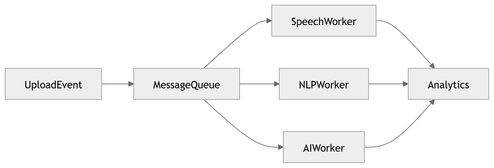
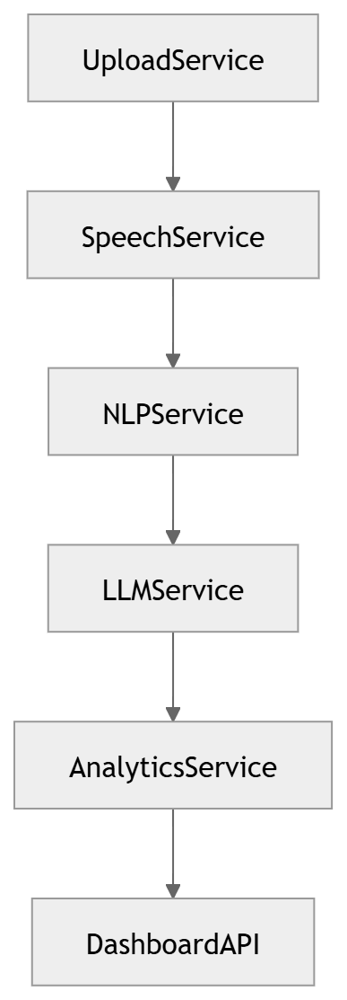

# Event-Driven Backend

Asynchronous, decoupled service communication.

### 46 · [Event Driven Backend](../diagrams/04_Backend/46_Event_Driven_Backend.md)

Event-driven backend.

### 05 · [Service Communication](../diagrams/01_System_Overview/05_Service_Communication.md)

Define inter-service communication patterns.

---

[⬆ Diagram Index](../architecture_index.md) &nbsp;|&nbsp; [🏠 Home](../index.md)
