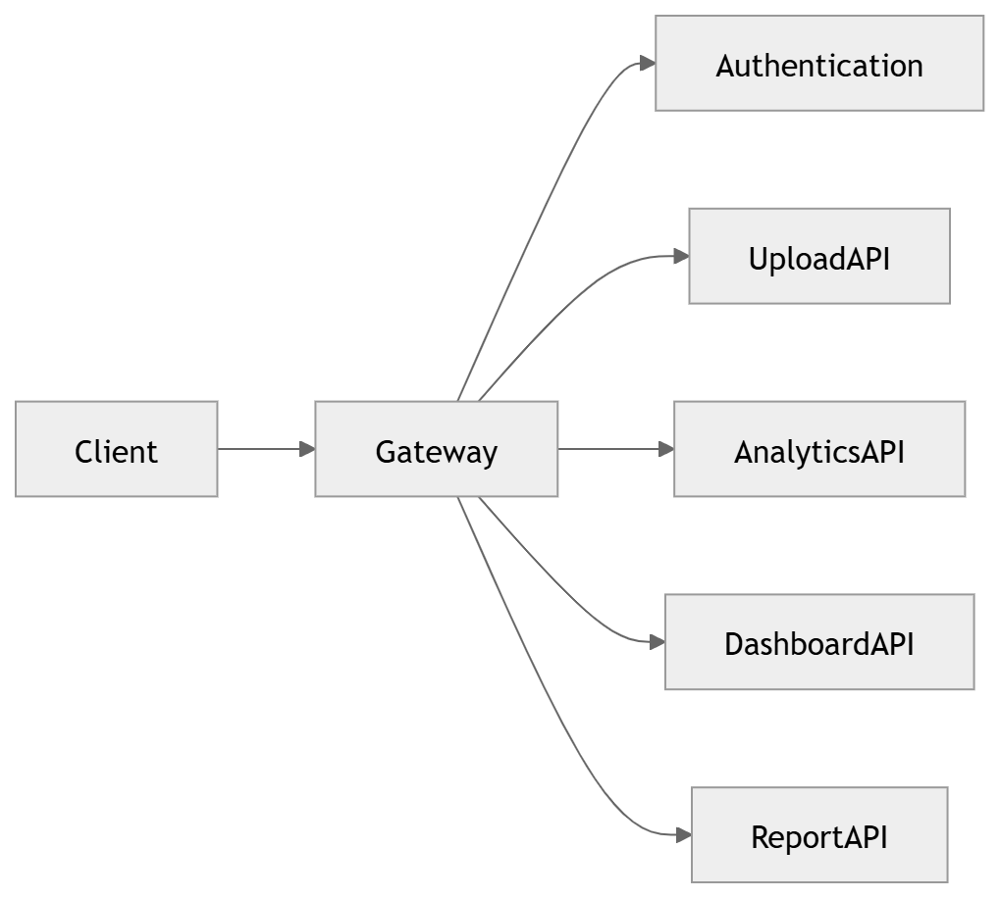
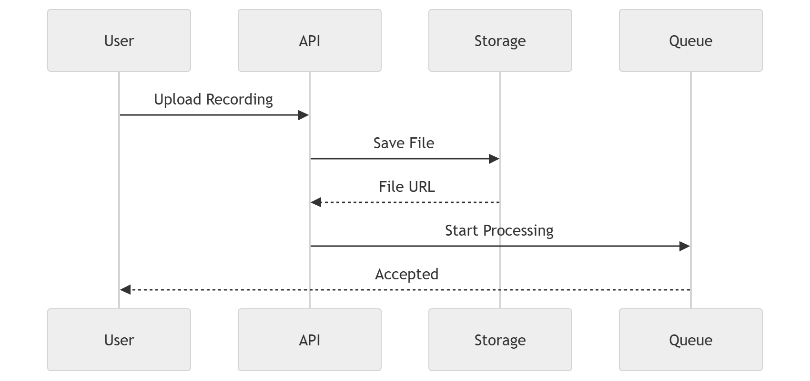
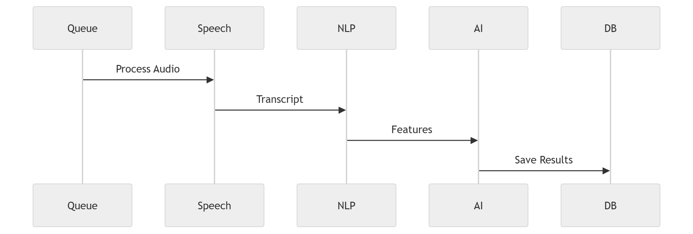
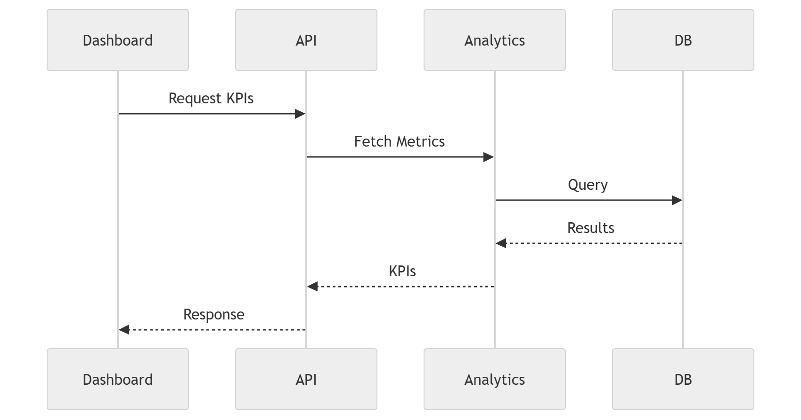
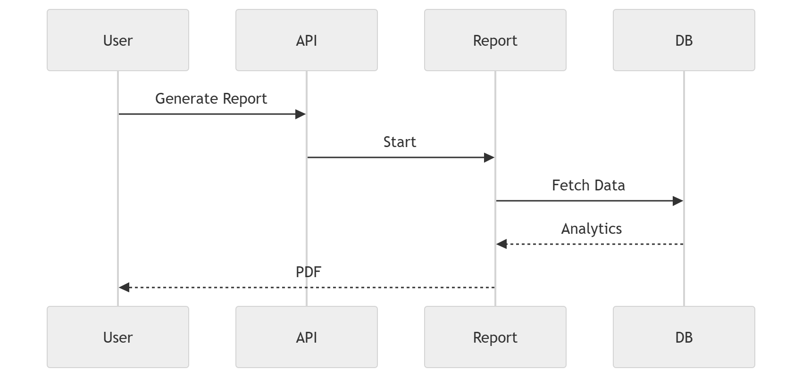
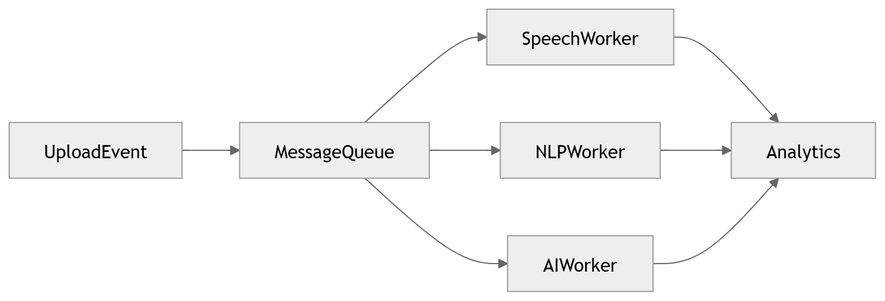
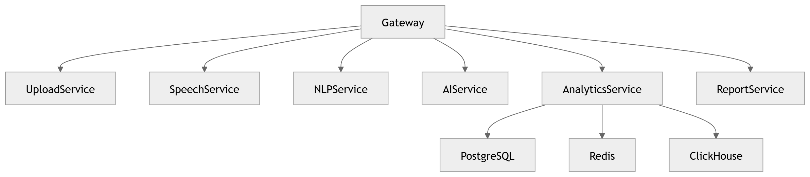
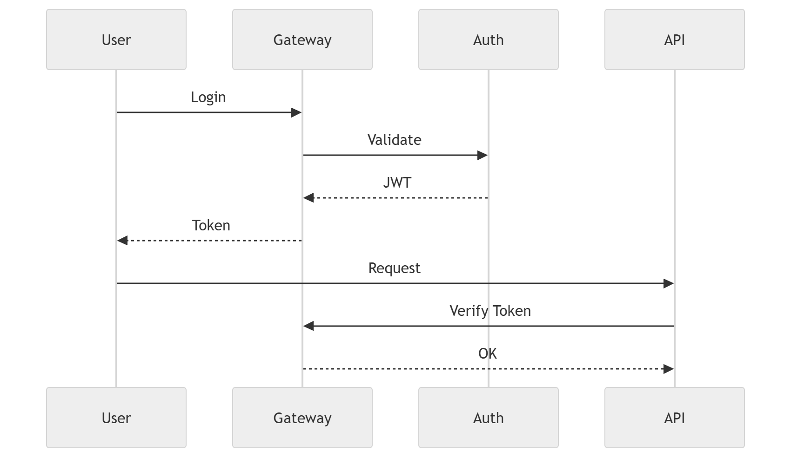
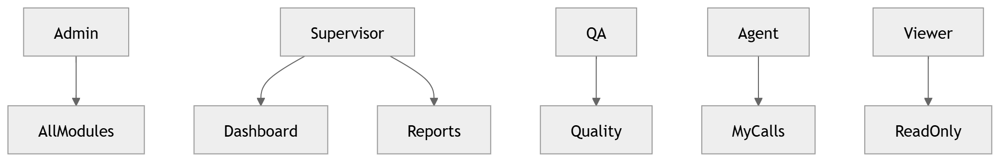

# Backend Architecture

Gateway, request lifecycles, event-driven services, auth and RBAC.

## Topic pages

- [API](api.md)
- [Authentication](authentication.md)
- [Services](services.md)
- [Event-Driven](event-driven.md)

## All diagrams in this section

### 41 · [API Gateway](../diagrams/04_Backend/41_API_Gateway.md)

API gateway architecture.

### 42 · [Upload API](../diagrams/04_Backend/42_Upload_API.md)

Upload API & ingestion.

### 43 · [Processing Sequence](../diagrams/04_Backend/43_Processing_Sequence.md)

Processing sequence (timing).

### 44 · [Dashboard Request](../diagrams/04_Backend/44_Dashboard_Request.md)

Dashboard request lifecycle.

### 45 · [Report Generation](../diagrams/04_Backend/45_Report_Generation.md)

Report generation.

### 46 · [Event Driven Backend](../diagrams/04_Backend/46_Event_Driven_Backend.md)

Event-driven backend.

### 47 · [Backend Service Dependency](../diagrams/04_Backend/47_Backend_Service_Dependency.md)

Backend service dependency map.

### 48 · [Authentication](../diagrams/04_Backend/48_Authentication.md)

Authentication flow.

### 49 · [RBAC](../diagrams/04_Backend/49_RBAC.md)

Role-based access control.

### 50 · [Backend Overview](../diagrams/04_Backend/50_Backend_Overview.md)

Backend overview.

---

[⬆ Diagram Index](../architecture_index.md) &nbsp;|&nbsp; [🏠 Home](../index.md)
