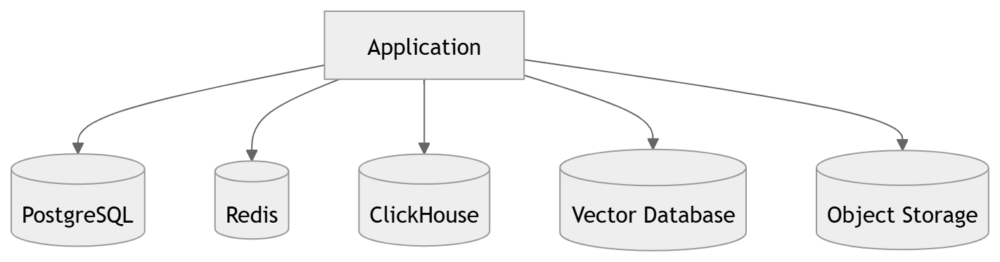
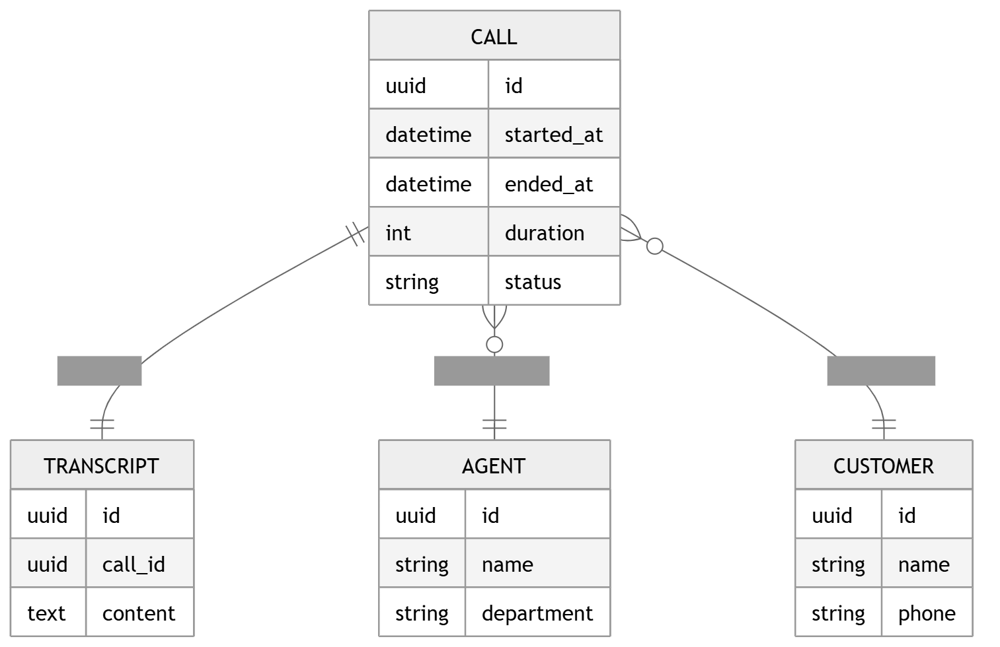
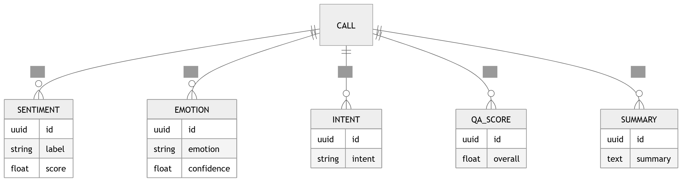
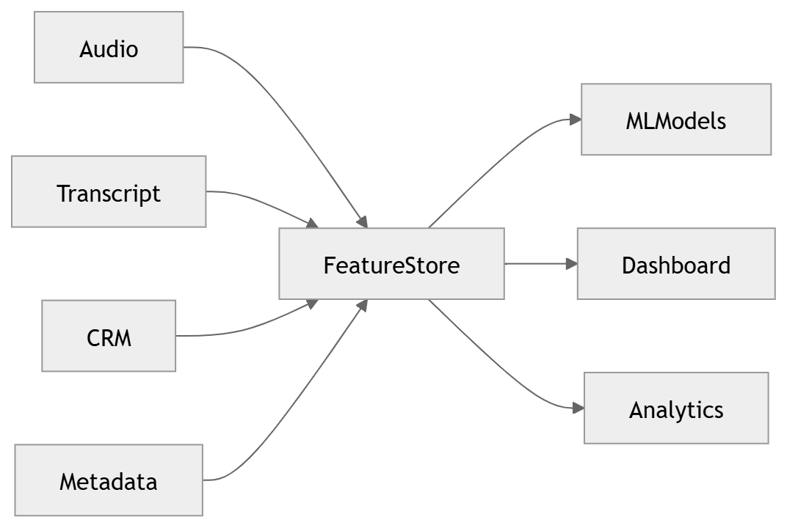
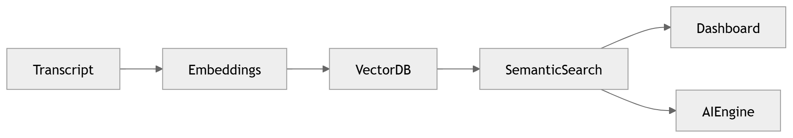
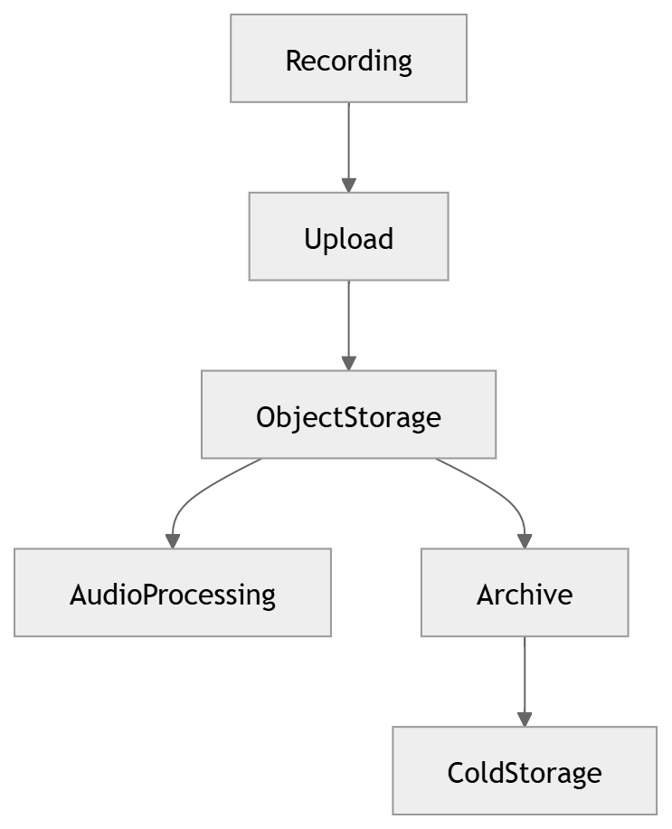
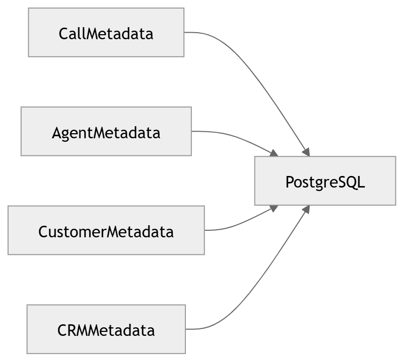
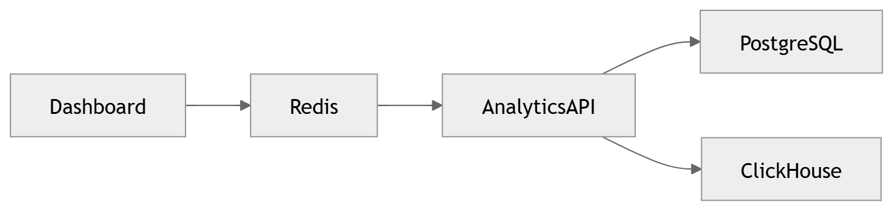
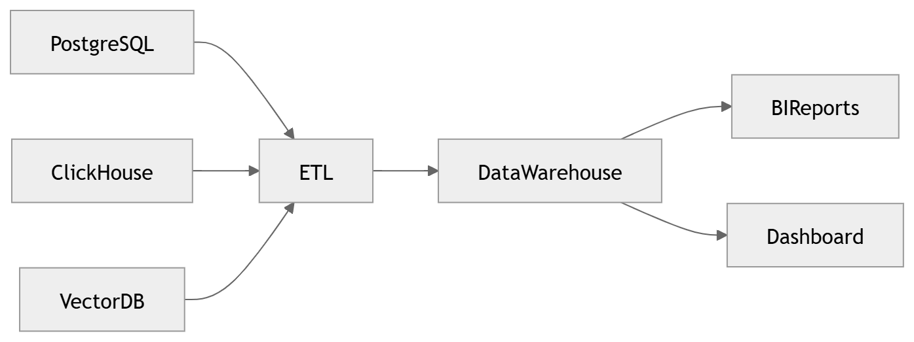
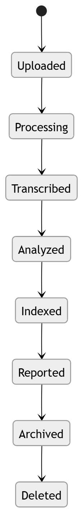

# Data Architecture

Operational, analytical, vector, feature, object and cache storage.

## Topic pages

- [Relational / OLTP](relational.md)
- [Warehouse](warehouse.md)
- [Vector DB](vector-db.md)
- [Feature Store](feature-store.md)

## All diagrams in this section

### 31 · [Database Architecture](../diagrams/03_Data_Architecture/31_Database_Architecture.md)

Database architecture overview.

### 32 · [ER Diagram](../diagrams/03_Data_Architecture/32_ER_Diagram.md)

Operational entity-relationship model.

### 33 · [Analytics ERD](../diagrams/03_Data_Architecture/33_Analytics_ERD.md)

Analytics / warehouse data model.

### 34 · [Feature Store](../diagrams/03_Data_Architecture/34_Feature_Store.md)

Feature store architecture.

### 35 · [Vector Search](../diagrams/03_Data_Architecture/35_Vector_Search.md)

Vector search architecture.

### 36 · [Object Storage](../diagrams/03_Data_Architecture/36_Object_Storage.md)

Object storage architecture.

### 37 · [Metadata Storage](../diagrams/03_Data_Architecture/37_Metadata_Storage.md)

Metadata storage.

### 38 · [Cache Architecture](../diagrams/03_Data_Architecture/38_Cache_Architecture.md)

Cache architecture.

### 39 · [Analytics Warehouse](../diagrams/03_Data_Architecture/39_Analytics_Warehouse.md)

Analytics warehouse.

### 40 · [Data Lifecycle](../diagrams/03_Data_Architecture/40_Data_Lifecycle.md)

Data lifecycle & retention.

---

[⬆ Diagram Index](../architecture_index.md) &nbsp;|&nbsp; [🏠 Home](../index.md)
