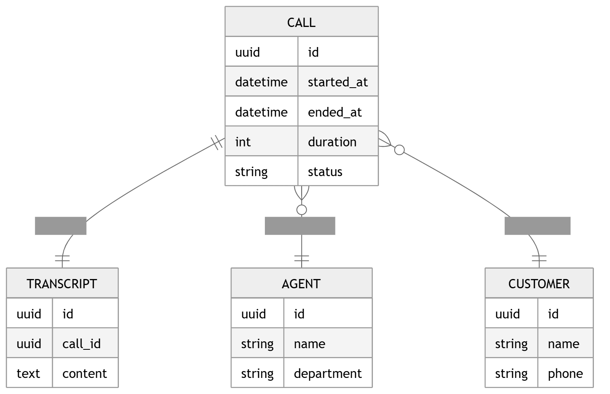
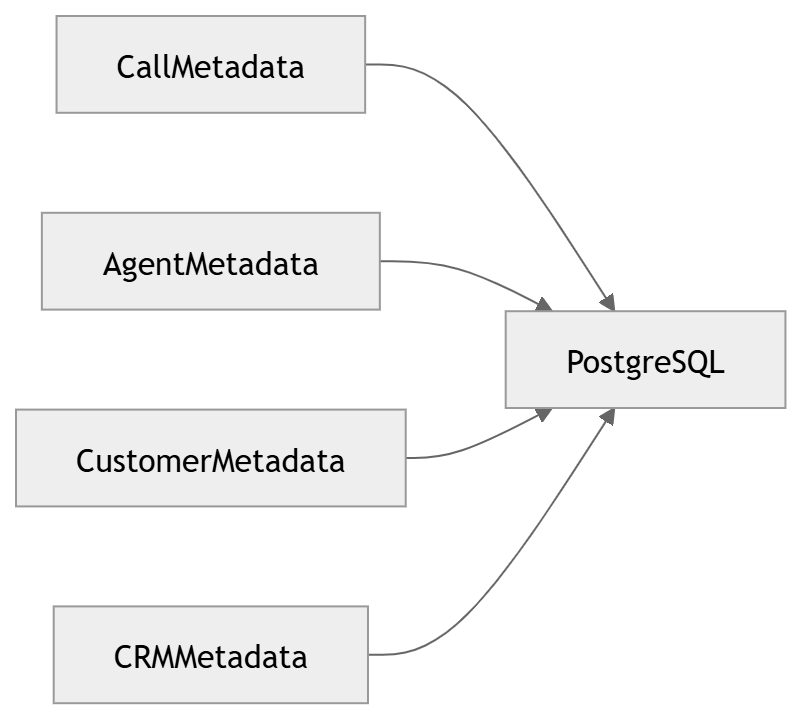

# Relational / OLTP

The transactional data model and metadata catalog.

### 32 · [ER Diagram](../diagrams/03_Data_Architecture/32_ER_Diagram.md)

Operational entity-relationship model.

### 37 · [Metadata Storage](../diagrams/03_Data_Architecture/37_Metadata_Storage.md)

Metadata storage.

---

[⬆ Diagram Index](../architecture_index.md) &nbsp;|&nbsp; [🏠 Home](../index.md)
