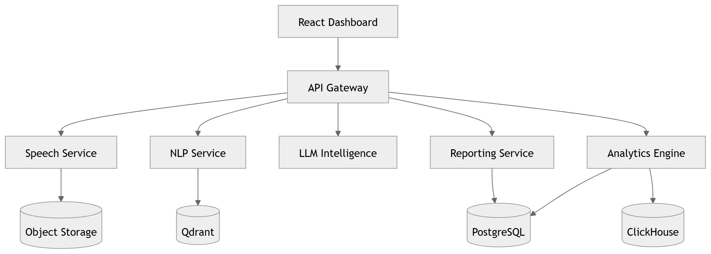
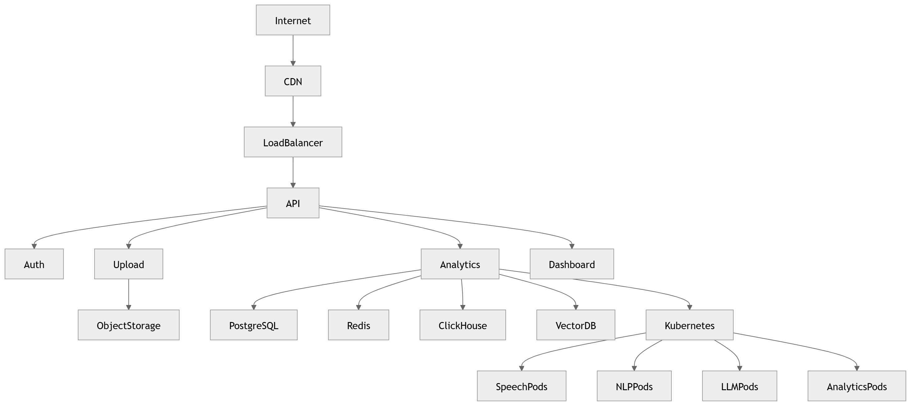

# Kubernetes

Orchestration of the containerized workloads.

### 03 · [Container Diagram](../diagrams/01_System_Overview/03_Container_Diagram.md)

C4 Level-2 container decomposition.

### P12 · [Infrastructure](../diagrams/05_Product/P12_Infrastructure.md)

Infrastructure program board.

---

[⬆ Diagram Index](../architecture_index.md) &nbsp;|&nbsp; [🏠 Home](../index.md)
