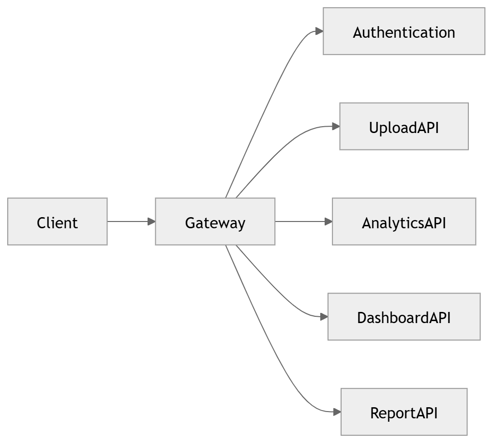
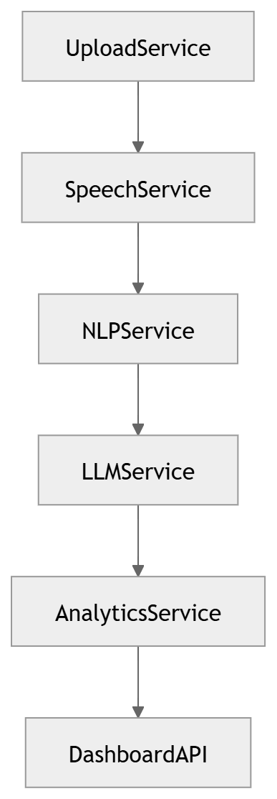

# Networking

Edge, service-to-service and network topology.

### 41 · [API Gateway](../diagrams/04_Backend/41_API_Gateway.md)

API gateway architecture.

### 05 · [Service Communication](../diagrams/01_System_Overview/05_Service_Communication.md)

Define inter-service communication patterns.

---

[⬆ Diagram Index](../architecture_index.md) &nbsp;|&nbsp; [🏠 Home](../index.md)
