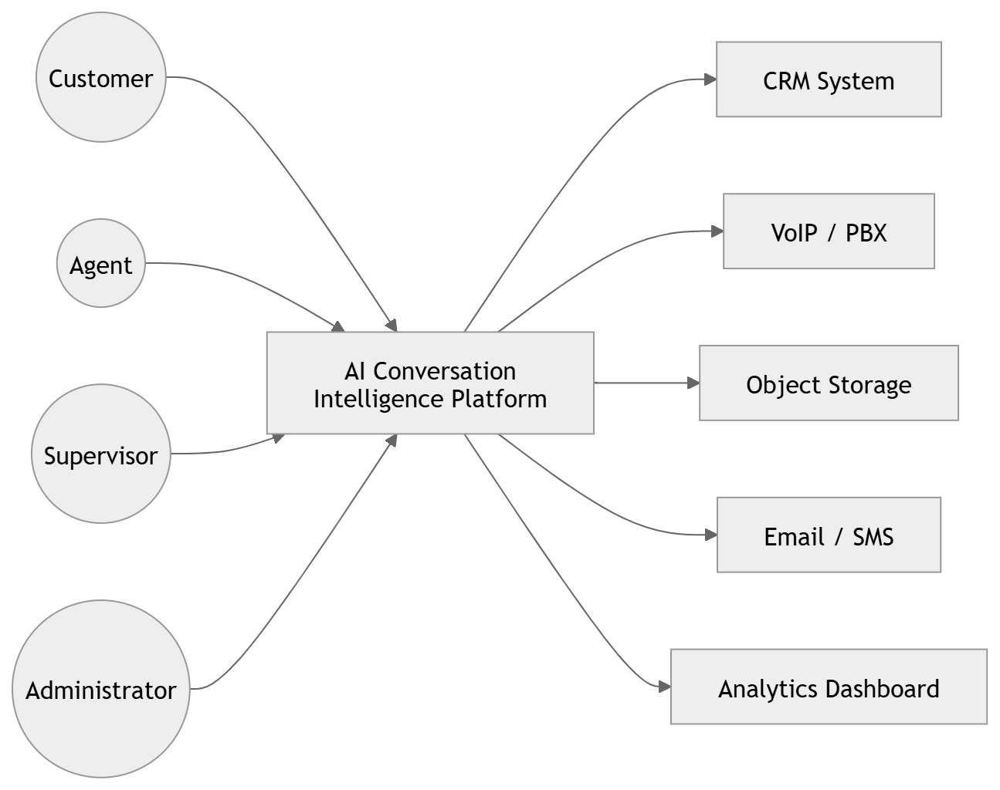

# 01 · System Context Diagram

> **Section:** [System Overview](../../03-system-overview.md) &nbsp;|&nbsp; **Diagram ID:** `01`

## Purpose

Establish the system boundary and external actors.

## Description

C4 Level-1 context view. Shows the platform as a single box and the people (agents, supervisors, QA, customers, admins) and external systems (telephony/CCaaS, identity, storage) that interact with it.

## Diagram

## Inputs

- Live/recorded call audio from telephony/CCaaS
- User interactions

## Outputs

- Conversation intelligence
- Dashboards
- Alerts & reports

## Dependencies

- Telephony / CCaaS
- Identity provider
- Object storage

## Business Value

Aligns every stakeholder on scope before drilling into internals.

## Technical Notes

Read this before any other diagram; it frames all downstream views.

## Related Diagrams

- [02 · High Level Architecture](../01_System_Overview/02_High_Level_Architecture.md)
- [03 · Container Diagram](../01_System_Overview/03_Container_Diagram.md)
- [10 · Overall Data Flow](../01_System_Overview/10_Overall_Data_Flow.md)
- [06 · Call Processing Overview](../01_System_Overview/06_Call_Processing_Overview.md)

---

### Navigation

⬆ [Diagram Index](../../architecture_index.md)  &nbsp;|&nbsp;  ➡ Next: [02 · High Level Architecture](../01_System_Overview/02_High_Level_Architecture.md)
