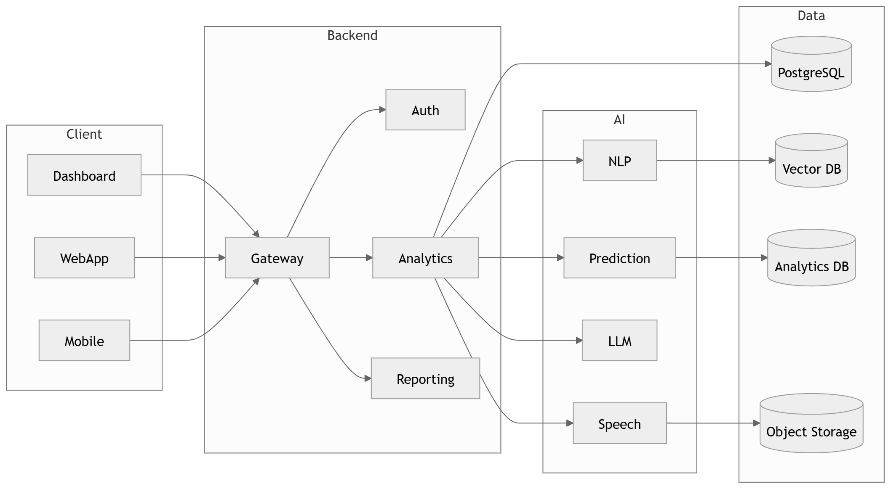

# 02 · High Level Architecture

> **Section:** [System Overview](../../03-system-overview.md) &nbsp;|&nbsp; **Diagram ID:** `02`

## Purpose

Show the major layers and how they compose end to end.

## Description

High-level architecture spanning ingestion, AI processing, data, backend services and presentation. The bridge between the context view and the detailed container view.

## Diagram

## Inputs

- Call audio
- Metadata

## Outputs

- Processed intelligence
- Analytics

## Dependencies

- AI services
- Data tier
- Backend
- Dashboards

## Business Value

Gives engineers and leadership a shared mental model of the system.

## Technical Notes

Layer boundaries here map 1:1 onto the documentation sections.

## Related Diagrams

- [01 · System Context Diagram](../01_System_Overview/01_System_Context_Diagram.md)
- [03 · Container Diagram](../01_System_Overview/03_Container_Diagram.md)
- [07 · AI Service Architecture](../01_System_Overview/07_AI_Service_Architecture.md)
- [11 · End to End AI Pipeline](../02_AI_Pipeline/11_End_to_End_AI_Pipeline.md)
- [31 · Database Architecture](../03_Data_Architecture/31_Database_Architecture.md)

---

### Navigation

⬅ Previous: [01 · System Context Diagram](../01_System_Overview/01_System_Context_Diagram.md)  &nbsp;|&nbsp;  ⬆ [Diagram Index](../../architecture_index.md)  &nbsp;|&nbsp;  ➡ Next: [03 · Container Diagram](../01_System_Overview/03_Container_Diagram.md)
