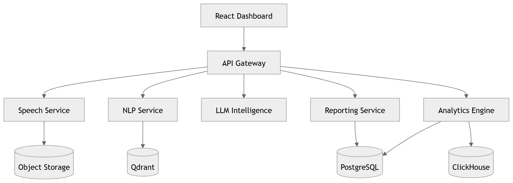

# 03 · Container Diagram

> **Section:** [System Overview](../../03-system-overview.md) &nbsp;|&nbsp; **Diagram ID:** `03`

## Purpose

C4 Level-2 container decomposition.

## Description

Decomposes the platform into deployable containers (API gateway, ingestion, AI workers, datastores, dashboard SPA) and the protocols between them.

## Diagram

## Inputs

- External requests
- Audio streams

## Outputs

- Container interaction map

## Dependencies

- Microservices
- Datastores
- Message bus

## Business Value

Defines the unit of deployment and ownership boundaries.

## Technical Notes

Aligns with Kubernetes workloads in the Infrastructure board.

## Related Diagrams

- [02 · High Level Architecture](../01_System_Overview/02_High_Level_Architecture.md)
- [04 · Microservice Dependency](../01_System_Overview/04_Microservice_Dependency.md)
- [05 · Service Communication](../01_System_Overview/05_Service_Communication.md)
- [41 · API Gateway](../04_Backend/41_API_Gateway.md)
- [50 · Backend Overview](../04_Backend/50_Backend_Overview.md)

---

### Navigation

⬅ Previous: [02 · High Level Architecture](../01_System_Overview/02_High_Level_Architecture.md)  &nbsp;|&nbsp;  ⬆ [Diagram Index](../../architecture_index.md)  &nbsp;|&nbsp;  ➡ Next: [04 · Microservice Dependency](../01_System_Overview/04_Microservice_Dependency.md)
