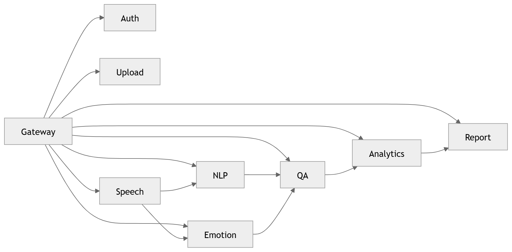

# 04 · Microservice Dependency

> **Section:** [System Overview](../../03-system-overview.md) &nbsp;|&nbsp; **Diagram ID:** `04`

## Purpose

Map dependencies between microservices.

## Description

Directed dependency graph of the microservice estate, surfacing coupling, fan-in/fan-out hotspots and potential single points of failure.

## Diagram

## Inputs

- Service registry

## Outputs

- Dependency graph

## Dependencies

- Service mesh
- Message bus

## Business Value

Informs blast-radius analysis and safe deployment ordering.

## Technical Notes

Compare with the backend service dependency view (47).

## Related Diagrams

- [03 · Container Diagram](../01_System_Overview/03_Container_Diagram.md)
- [05 · Service Communication](../01_System_Overview/05_Service_Communication.md)
- [47 · Backend Service Dependency](../04_Backend/47_Backend_Service_Dependency.md)
- [46 · Event Driven Backend](../04_Backend/46_Event_Driven_Backend.md)

---

### Navigation

⬅ Previous: [03 · Container Diagram](../01_System_Overview/03_Container_Diagram.md)  &nbsp;|&nbsp;  ⬆ [Diagram Index](../../architecture_index.md)  &nbsp;|&nbsp;  ➡ Next: [05 · Service Communication](../01_System_Overview/05_Service_Communication.md)
