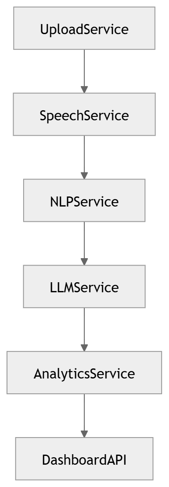

# 05 · Service Communication

> **Section:** [System Overview](../../03-system-overview.md) &nbsp;|&nbsp; **Diagram ID:** `05`

## Purpose

Define inter-service communication patterns.

## Description

Synchronous (REST/gRPC) versus asynchronous (events/queues) paths between services, including ret, timeout and back-pressure strategy.

## Diagram

## Inputs

- Service calls
- Events

## Outputs

- Communication contract

## Dependencies

- Message broker
- Service mesh

## Business Value

Prevents cascading failures through clear async boundaries.

## Technical Notes

Async paths feed the event-driven backend (46).

## Related Diagrams

- [04 · Microservice Dependency](../01_System_Overview/04_Microservice_Dependency.md)
- [46 · Event Driven Backend](../04_Backend/46_Event_Driven_Backend.md)
- [43 · Processing Sequence](../04_Backend/43_Processing_Sequence.md)
- [47 · Backend Service Dependency](../04_Backend/47_Backend_Service_Dependency.md)

---

### Navigation

⬅ Previous: [04 · Microservice Dependency](../01_System_Overview/04_Microservice_Dependency.md)  &nbsp;|&nbsp;  ⬆ [Diagram Index](../../architecture_index.md)  &nbsp;|&nbsp;  ➡ Next: [06 · Call Processing Overview](../01_System_Overview/06_Call_Processing_Overview.md)
