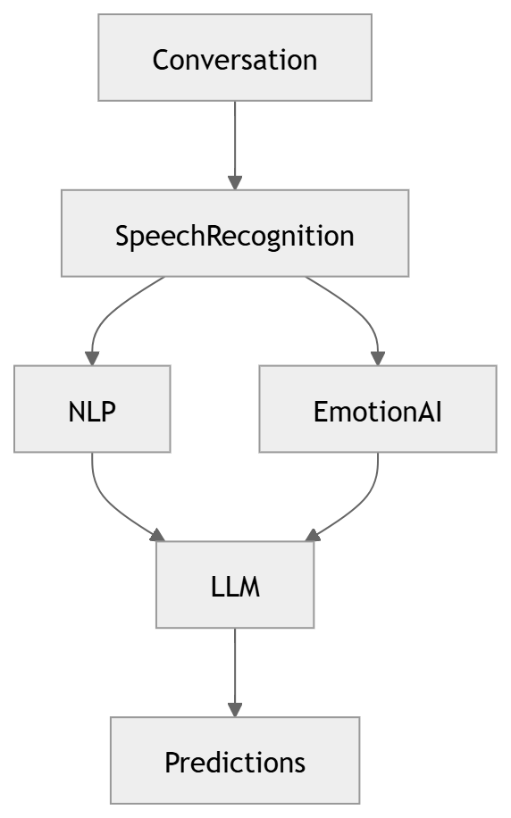

# 07 · AI Service Architecture

> **Section:** [System Overview](../../03-system-overview.md) &nbsp;|&nbsp; **Diagram ID:** `07`

## Purpose

Architecture of the AI service plane.

## Description

How AI capabilities are packaged as services/workers, model serving, GPU scheduling and the contract they expose to the rest of the platform.

## Diagram

## Inputs

- Audio/text features

## Outputs

- Model inferences

## Dependencies

- Model registry
- Feature store
- GPU pool

## Business Value

Decouples model lifecycle from application code.

## Technical Notes

Backs every diagram in the AI Pipeline section.

## Related Diagrams

- [11 · End to End AI Pipeline](../02_AI_Pipeline/11_End_to_End_AI_Pipeline.md)
- [23 · LLM Orchestration](../02_AI_Pipeline/23_LLM_Orchestration.md)
- [29 · AI Decision Engine](../02_AI_Pipeline/29_AI_Decision_Engine.md)
- [34 · Feature Store](../03_Data_Architecture/34_Feature_Store.md)

---

### Navigation

⬅ Previous: [06 · Call Processing Overview](../01_System_Overview/06_Call_Processing_Overview.md)  &nbsp;|&nbsp;  ⬆ [Diagram Index](../../architecture_index.md)  &nbsp;|&nbsp;  ➡ Next: [08 · Dashboard Modules](../01_System_Overview/08_Dashboard_Modules.md)
