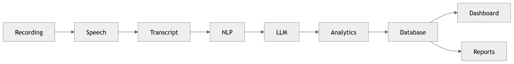

# 10 · Overall Data Flow

> **Section:** [System Overview](../../03-system-overview.md) &nbsp;|&nbsp; **Diagram ID:** `10`

## Purpose

Overall data flow across the platform.

## Description

Traces data from capture through each processing stage to storage and presentation, including the key transformations.

## Diagram

## Inputs

- Raw audio
- Metadata

## Outputs

- Stored, queryable intelligence

## Dependencies

- Ingestion
- AI pipeline
- Data tier

## Business Value

The canonical 'where does my data go' reference.

## Technical Notes

Pairs with the data lifecycle (40) for retention detail.

## Related Diagrams

- [06 · Call Processing Overview](../01_System_Overview/06_Call_Processing_Overview.md)
- [11 · End to End AI Pipeline](../02_AI_Pipeline/11_End_to_End_AI_Pipeline.md)
- [40 · Data Lifecycle](../03_Data_Architecture/40_Data_Lifecycle.md)
- [30 · Complete AI Pipeline](../02_AI_Pipeline/30_Complete_AI_Pipeline.md)

---

### Navigation

⬅ Previous: [09 · Analytics Architecture](../01_System_Overview/09_Analytics_Architecture.md)  &nbsp;|&nbsp;  ⬆ [Diagram Index](../../architecture_index.md)  &nbsp;|&nbsp;  ➡ Next: [11 · End to End AI Pipeline](../02_AI_Pipeline/11_End_to_End_AI_Pipeline.md)
