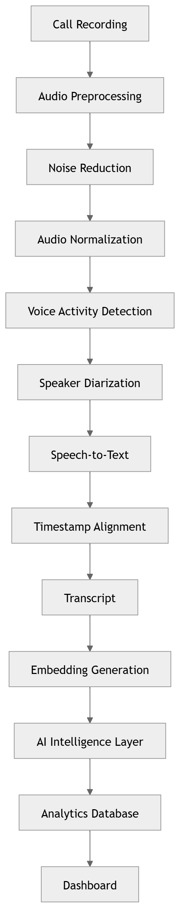

# 11 · End to End AI Pipeline

> **Section:** [AI Pipeline](../../ai/overview.md) &nbsp;|&nbsp; **Diagram ID:** `11`

## Purpose

End-to-end AI processing pipeline.

## Description

The master AI flow: audio in, sequential/parallel enrichment stages, and structured intelligence out. Parent of diagrams 12-29.

## Diagram

## Inputs

- Call audio

## Outputs

- Conversation intelligence record

## Dependencies

- All AI stage services

## Business Value

Single picture of how raw audio becomes actionable insight.

## Technical Notes

Each downstream box expands into its own diagram.

## Related Diagrams

- [12 · Audio Processing](../02_AI_Pipeline/12_Audio_Processing.md)
- [13 · Speech Recognition](../02_AI_Pipeline/13_Speech_Recognition.md)
- [15 · Emotion Recognition](../02_AI_Pipeline/15_Emotion_Recognition.md)
- [16 · NLP Pipeline](../02_AI_Pipeline/16_NLP_Pipeline.md)
- [22 · Conversation Intelligence](../02_AI_Pipeline/22_Conversation_Intelligence.md)
- [30 · Complete AI Pipeline](../02_AI_Pipeline/30_Complete_AI_Pipeline.md)

---

### Navigation

⬅ Previous: [10 · Overall Data Flow](../01_System_Overview/10_Overall_Data_Flow.md)  &nbsp;|&nbsp;  ⬆ [Diagram Index](../../architecture_index.md)  &nbsp;|&nbsp;  ➡ Next: [12 · Audio Processing](../02_AI_Pipeline/12_Audio_Processing.md)
