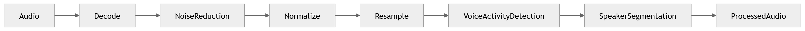

# 12 · Audio Processing

> **Section:** [AI Pipeline](../../ai/overview.md) &nbsp;|&nbsp; **Diagram ID:** `12`

## Purpose

Audio pre-processing stage.

## Description

Decoding, resampling, channel splitting, noise reduction and voice-activity detection that condition audio for ASR.

## Diagram

## Inputs

- Raw call audio

## Outputs

- Clean, normalized audio frames

## Dependencies

- DSP libraries
- VAD model

## Business Value

Quality here gates the accuracy of every later stage.

## Technical Notes

Channel split enables speaker diarization (14).

## Related Diagrams

- [11 · End to End AI Pipeline](../02_AI_Pipeline/11_End_to_End_AI_Pipeline.md)
- [13 · Speech Recognition](../02_AI_Pipeline/13_Speech_Recognition.md)
- [14 · Speaker Diarization](../02_AI_Pipeline/14_Speaker_Diarization.md)

---

### Navigation

⬅ Previous: [11 · End to End AI Pipeline](../02_AI_Pipeline/11_End_to_End_AI_Pipeline.md)  &nbsp;|&nbsp;  ⬆ [Diagram Index](../../architecture_index.md)  &nbsp;|&nbsp;  ➡ Next: [13 · Speech Recognition](../02_AI_Pipeline/13_Speech_Recognition.md)
