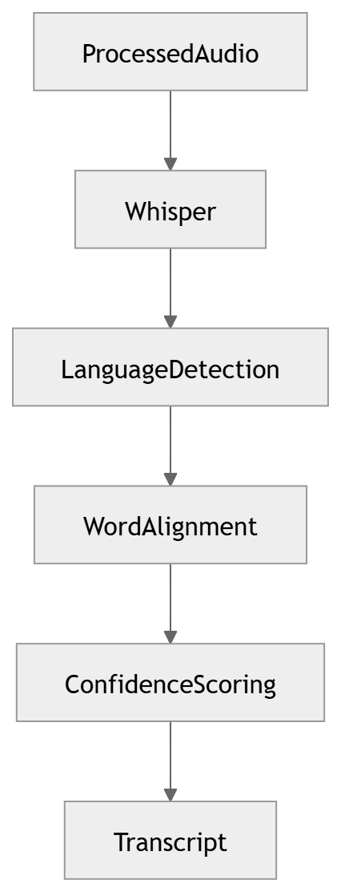

# 13 · Speech Recognition

> **Section:** [AI Pipeline](../../ai/overview.md) &nbsp;|&nbsp; **Diagram ID:** `13`

## Purpose

Automatic speech recognition.

## Description

Converts conditioned audio into time-aligned transcripts with word-level confidence.

## Diagram

## Inputs

- Clean audio frames

## Outputs

- Transcript + timestamps + confidence

## Dependencies

- ASR model
- Language models

## Business Value

The transcript is the substrate for all NLP and LLM analysis.

## Technical Notes

Diarization (14) attributes each token to a speaker.

## Related Diagrams

- [12 · Audio Processing](../02_AI_Pipeline/12_Audio_Processing.md)
- [14 · Speaker Diarization](../02_AI_Pipeline/14_Speaker_Diarization.md)
- [16 · NLP Pipeline](../02_AI_Pipeline/16_NLP_Pipeline.md)
- [22 · Conversation Intelligence](../02_AI_Pipeline/22_Conversation_Intelligence.md)

---

### Navigation

⬅ Previous: [12 · Audio Processing](../02_AI_Pipeline/12_Audio_Processing.md)  &nbsp;|&nbsp;  ⬆ [Diagram Index](../../architecture_index.md)  &nbsp;|&nbsp;  ➡ Next: [14 · Speaker Diarization](../02_AI_Pipeline/14_Speaker_Diarization.md)
