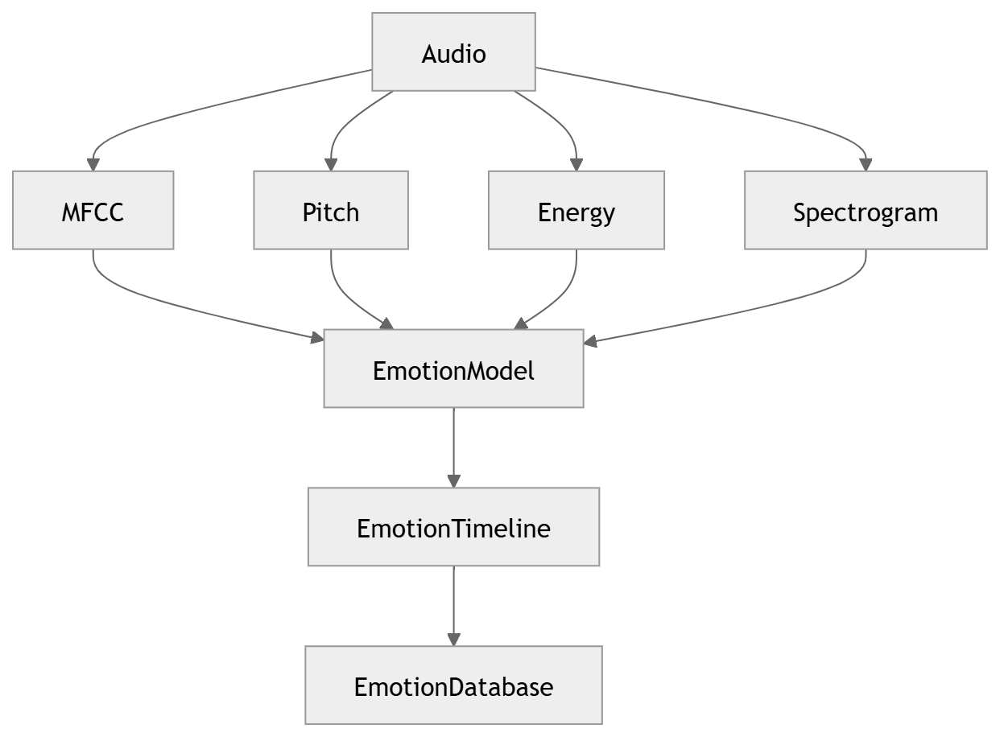

# 15 · Emotion Recognition

> **Section:** [AI Pipeline](../../ai/overview.md) &nbsp;|&nbsp; **Diagram ID:** `15`

## Purpose

Emotion / affect recognition.

## Description

Detects emotional state and tonal shifts from acoustic and lexical features per speaker segment.

## Diagram

## Inputs

- Audio features
- Speaker segments

## Outputs

- Emotion timeline

## Dependencies

- Emotion model

## Business Value

Surfaces escalation risk and customer frustration early.

## Technical Notes

Combines with sentiment (18) in conversation intelligence (22).

## Related Diagrams

- [14 · Speaker Diarization](../02_AI_Pipeline/14_Speaker_Diarization.md)
- [18 · Sentiment Analysis](../02_AI_Pipeline/18_Sentiment_Analysis.md)
- [22 · Conversation Intelligence](../02_AI_Pipeline/22_Conversation_Intelligence.md)

---

### Navigation

⬅ Previous: [14 · Speaker Diarization](../02_AI_Pipeline/14_Speaker_Diarization.md)  &nbsp;|&nbsp;  ⬆ [Diagram Index](../../architecture_index.md)  &nbsp;|&nbsp;  ➡ Next: [16 · NLP Pipeline](../02_AI_Pipeline/16_NLP_Pipeline.md)
