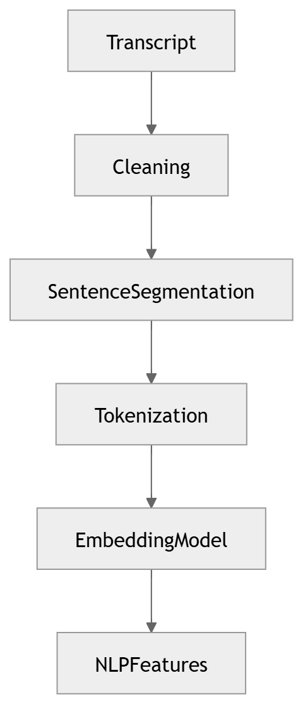

# 16 · NLP Pipeline

> **Section:** [AI Pipeline](../../ai/overview.md) &nbsp;|&nbsp; **Diagram ID:** `16`

## Purpose

Core NLP processing.

## Description

Tokenization, normalization and the linguistic backbone that feeds intent, sentiment, topic, NER and keyword stages.

## Diagram

## Inputs

- Transcript

## Outputs

- Annotated linguistic structures

## Dependencies

- NLP models

## Business Value

Shared preprocessing avoids duplicated work across NLP tasks.

## Technical Notes

Parent of diagrams 17-21.

## Related Diagrams

- [13 · Speech Recognition](../02_AI_Pipeline/13_Speech_Recognition.md)
- [17 · Intent Detection](../02_AI_Pipeline/17_Intent_Detection.md)
- [18 · Sentiment Analysis](../02_AI_Pipeline/18_Sentiment_Analysis.md)
- [19 · Topic Modeling](../02_AI_Pipeline/19_Topic_Modeling.md)
- [20 · Named Entity Recognition](../02_AI_Pipeline/20_Named_Entity_Recognition.md)
- [21 · Keyword Extraction](../02_AI_Pipeline/21_Keyword_Extraction.md)

---

### Navigation

⬅ Previous: [15 · Emotion Recognition](../02_AI_Pipeline/15_Emotion_Recognition.md)  &nbsp;|&nbsp;  ⬆ [Diagram Index](../../architecture_index.md)  &nbsp;|&nbsp;  ➡ Next: [17 · Intent Detection](../02_AI_Pipeline/17_Intent_Detection.md)
