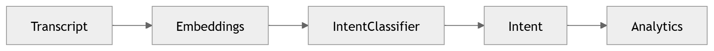

# 17 · Intent Detection

> **Section:** [AI Pipeline](../../ai/overview.md) &nbsp;|&nbsp; **Diagram ID:** `17`

## Purpose

Intent detection.

## Description

Classifies caller intent(s) to drive routing, automation and analytics.

## Diagram

## Inputs

- NLP annotations

## Outputs

- Intent labels + confidence

## Dependencies

- Intent classifier

## Business Value

Powers call-reason analytics and automated next-best-action.

## Technical Notes

Often reconciled with LLM reasoning (23).

## Related Diagrams

- [16 · NLP Pipeline](../02_AI_Pipeline/16_NLP_Pipeline.md)
- [22 · Conversation Intelligence](../02_AI_Pipeline/22_Conversation_Intelligence.md)
- [23 · LLM Orchestration](../02_AI_Pipeline/23_LLM_Orchestration.md)

---

### Navigation

⬅ Previous: [16 · NLP Pipeline](../02_AI_Pipeline/16_NLP_Pipeline.md)  &nbsp;|&nbsp;  ⬆ [Diagram Index](../../architecture_index.md)  &nbsp;|&nbsp;  ➡ Next: [18 · Sentiment Analysis](../02_AI_Pipeline/18_Sentiment_Analysis.md)
