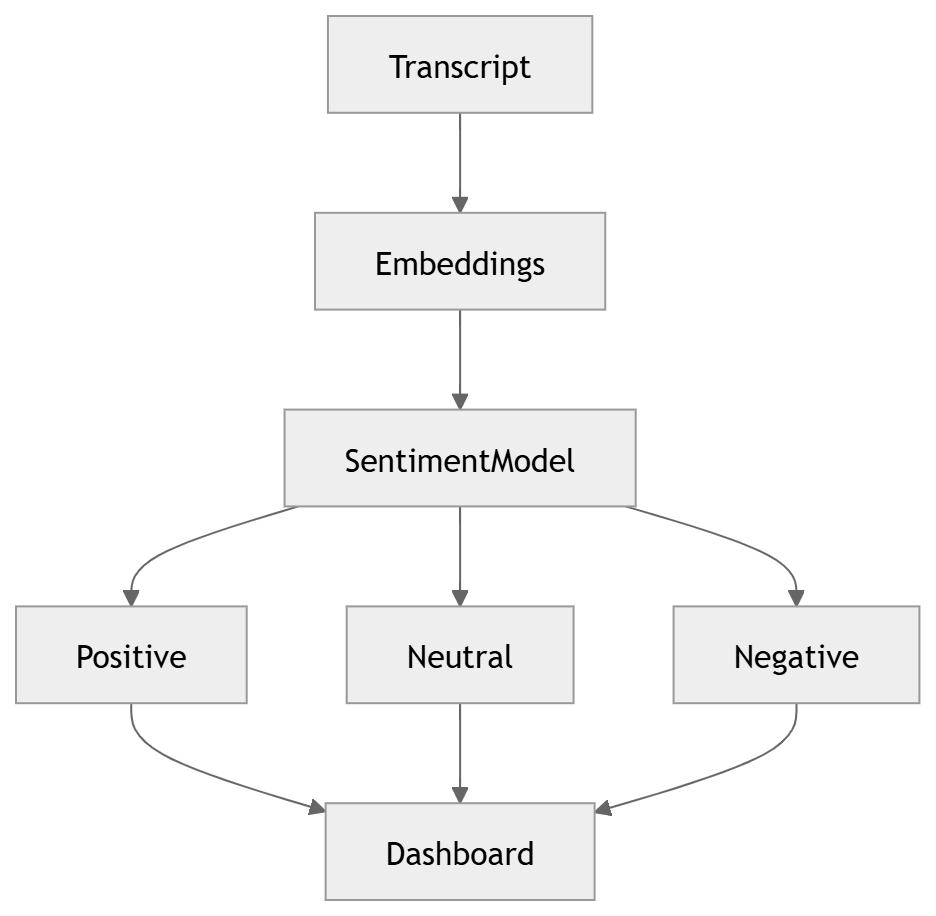

# 18 · Sentiment Analysis

> **Section:** [AI Pipeline](../../ai/overview.md) &nbsp;|&nbsp; **Diagram ID:** `18`

## Purpose

Sentiment analysis.

## Description

Scores polarity and trajectory across the conversation, per speaker and overall.

## Diagram

## Inputs

- NLP annotations
- Emotion timeline

## Outputs

- Sentiment scores/trend

## Dependencies

- Sentiment model

## Business Value

Key driver of CSAT prediction and QA scoring.

## Technical Notes

Complements acoustic emotion (15).

## Related Diagrams

- [15 · Emotion Recognition](../02_AI_Pipeline/15_Emotion_Recognition.md)
- [16 · NLP Pipeline](../02_AI_Pipeline/16_NLP_Pipeline.md)
- [22 · Conversation Intelligence](../02_AI_Pipeline/22_Conversation_Intelligence.md)
- [26 · Prediction Engine](../02_AI_Pipeline/26_Prediction_Engine.md)

---

### Navigation

⬅ Previous: [17 · Intent Detection](../02_AI_Pipeline/17_Intent_Detection.md)  &nbsp;|&nbsp;  ⬆ [Diagram Index](../../architecture_index.md)  &nbsp;|&nbsp;  ➡ Next: [19 · Topic Modeling](../02_AI_Pipeline/19_Topic_Modeling.md)
