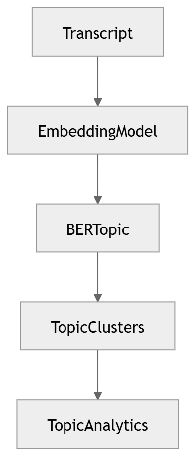

# 19 · Topic Modeling

> **Section:** [AI Pipeline](../../ai/overview.md) &nbsp;|&nbsp; **Diagram ID:** `19`

## Purpose

Topic modelling.

## Description

Clusters conversations into themes/topics for trend discovery.

## Diagram

## Inputs

- NLP annotations

## Outputs

- Topic assignments

## Dependencies

- Topic model

## Business Value

Reveals emerging issues without manual tagging.

## Technical Notes

Topics feed BI (25) and analytics aggregation (28).

## Related Diagrams

- [16 · NLP Pipeline](../02_AI_Pipeline/16_NLP_Pipeline.md)
- [22 · Conversation Intelligence](../02_AI_Pipeline/22_Conversation_Intelligence.md)
- [25 · Business Intelligence](../02_AI_Pipeline/25_Business_Intelligence.md)

---

### Navigation

⬅ Previous: [18 · Sentiment Analysis](../02_AI_Pipeline/18_Sentiment_Analysis.md)  &nbsp;|&nbsp;  ⬆ [Diagram Index](../../architecture_index.md)  &nbsp;|&nbsp;  ➡ Next: [20 · Named Entity Recognition](../02_AI_Pipeline/20_Named_Entity_Recognition.md)
