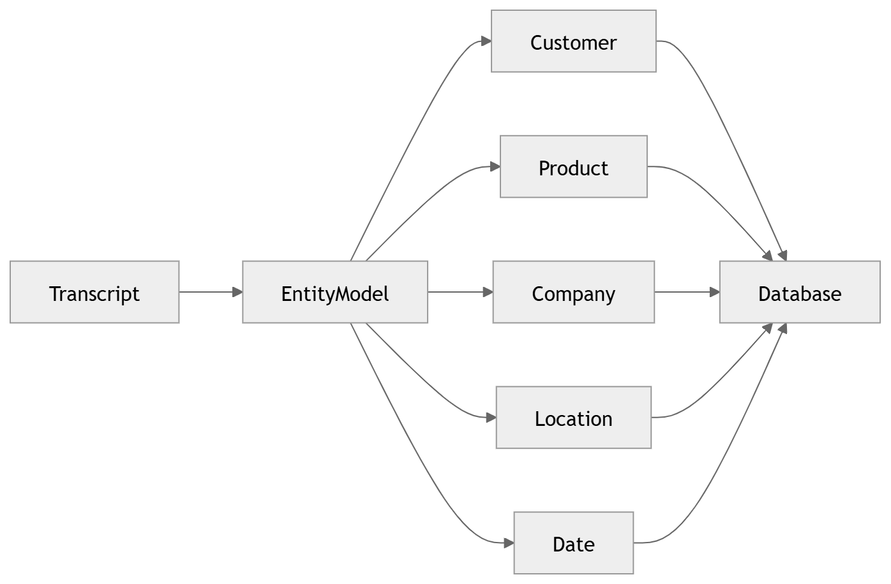

# 20 · Named Entity Recognition

> **Section:** [AI Pipeline](../../ai/overview.md) &nbsp;|&nbsp; **Diagram ID:** `20`

## Purpose

Named-entity recognition.

## Description

Extracts entities (names, accounts, products, PII) for compliance redaction and structured search.

## Diagram

## Inputs

- NLP annotations

## Outputs

- Entity spans + types

## Dependencies

- NER model

## Business Value

Enables PII redaction and entity-level analytics.

## Technical Notes

Drives compliance handling in QA evaluation (24).

## Related Diagrams

- [16 · NLP Pipeline](../02_AI_Pipeline/16_NLP_Pipeline.md)
- [21 · Keyword Extraction](../02_AI_Pipeline/21_Keyword_Extraction.md)
- [24 · QA Evaluation](../02_AI_Pipeline/24_QA_Evaluation.md)

---

### Navigation

⬅ Previous: [19 · Topic Modeling](../02_AI_Pipeline/19_Topic_Modeling.md)  &nbsp;|&nbsp;  ⬆ [Diagram Index](../../architecture_index.md)  &nbsp;|&nbsp;  ➡ Next: [21 · Keyword Extraction](../02_AI_Pipeline/21_Keyword_Extraction.md)
