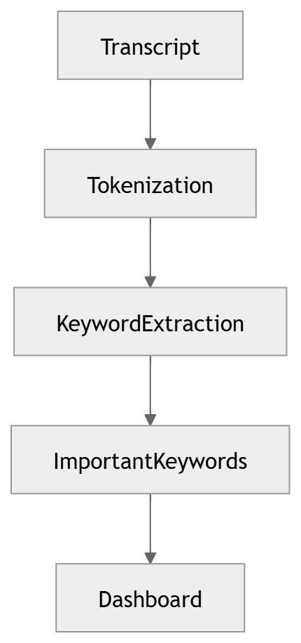

# 21 · Keyword Extraction

> **Section:** [AI Pipeline](../../ai/overview.md) &nbsp;|&nbsp; **Diagram ID:** `21`

## Purpose

Keyword / keyphrase extraction.

## Description

Surfaces salient terms per conversation for search and tagging.

## Diagram

## Inputs

- NLP annotations

## Outputs

- Ranked keywords

## Dependencies

- Keyword model

## Business Value

Improves searchability and lightweight tagging.

## Technical Notes

Feeds vector search (35) and BI (25).

## Related Diagrams

- [16 · NLP Pipeline](../02_AI_Pipeline/16_NLP_Pipeline.md)
- [20 · Named Entity Recognition](../02_AI_Pipeline/20_Named_Entity_Recognition.md)
- [35 · Vector Search](../03_Data_Architecture/35_Vector_Search.md)

---

### Navigation

⬅ Previous: [20 · Named Entity Recognition](../02_AI_Pipeline/20_Named_Entity_Recognition.md)  &nbsp;|&nbsp;  ⬆ [Diagram Index](../../architecture_index.md)  &nbsp;|&nbsp;  ➡ Next: [22 · Conversation Intelligence](../02_AI_Pipeline/22_Conversation_Intelligence.md)
