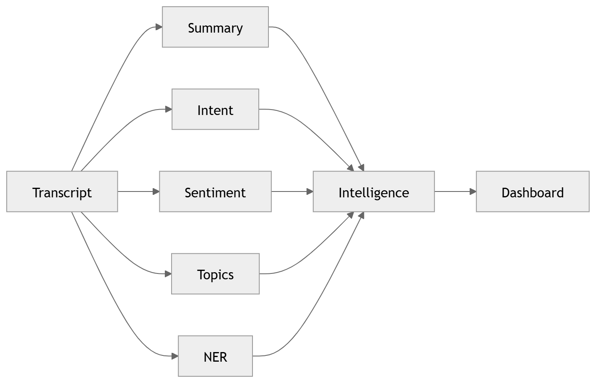

# 22 · Conversation Intelligence

> **Section:** [AI Pipeline](../../ai/overview.md) &nbsp;|&nbsp; **Diagram ID:** `22`

## Purpose

Conversation intelligence fusion.

## Description

Fuses transcript, diarization, emotion, sentiment, intent, topics and entities into a unified conversation record.

## Diagram

## Inputs

- All NLP/affect stage outputs

## Outputs

- Unified conversation intelligence object

## Dependencies

- Stage outputs
- Fusion logic

## Business Value

The single enriched artifact every downstream consumer reads.

## Technical Notes

Hand-off point into LLM (23) and analytics (28).

## Related Diagrams

- [13 · Speech Recognition](../02_AI_Pipeline/13_Speech_Recognition.md)
- [15 · Emotion Recognition](../02_AI_Pipeline/15_Emotion_Recognition.md)
- [18 · Sentiment Analysis](../02_AI_Pipeline/18_Sentiment_Analysis.md)
- [17 · Intent Detection](../02_AI_Pipeline/17_Intent_Detection.md)
- [23 · LLM Orchestration](../02_AI_Pipeline/23_LLM_Orchestration.md)
- [30 · Complete AI Pipeline](../02_AI_Pipeline/30_Complete_AI_Pipeline.md)

---

### Navigation

⬅ Previous: [21 · Keyword Extraction](../02_AI_Pipeline/21_Keyword_Extraction.md)  &nbsp;|&nbsp;  ⬆ [Diagram Index](../../architecture_index.md)  &nbsp;|&nbsp;  ➡ Next: [23 · LLM Orchestration](../02_AI_Pipeline/23_LLM_Orchestration.md)
