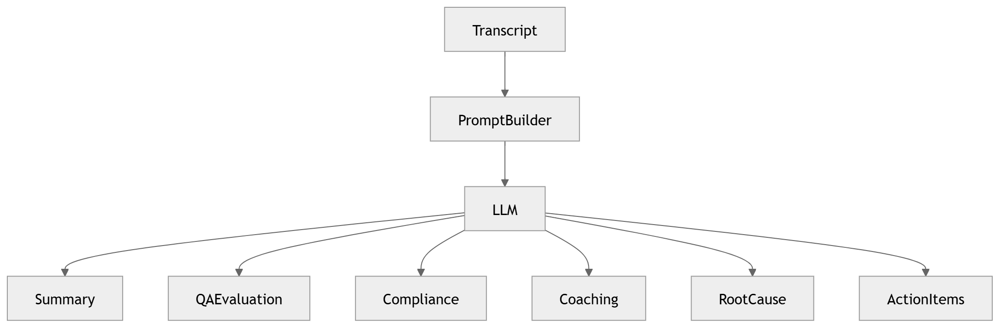

# 23 · LLM Orchestration

> **Section:** [AI Pipeline](../../ai/overview.md) &nbsp;|&nbsp; **Diagram ID:** `23`

## Purpose

LLM orchestration.

## Description

Coordinates prompting, tool/function calls, retrieval (RAG) and guardrails to generate summaries, reasoning and recommendations over the conversation record.

## Diagram

## Inputs

- Conversation intelligence object
- Retrieved context

## Outputs

- Summaries
- Reasoned insights
- Recommendations

## Dependencies

- LLM provider
- Vector search
- Prompt/guardrail layer

## Business Value

Adds higher-order reasoning beyond classical NLP.

## Technical Notes

Uses vector search (35); governed by guardrails/compliance.

## Related Diagrams

- [22 · Conversation Intelligence](../02_AI_Pipeline/22_Conversation_Intelligence.md)
- [24 · QA Evaluation](../02_AI_Pipeline/24_QA_Evaluation.md)
- [27 · Coaching Recommendation](../02_AI_Pipeline/27_Coaching_Recommendation.md)
- [29 · AI Decision Engine](../02_AI_Pipeline/29_AI_Decision_Engine.md)
- [35 · Vector Search](../03_Data_Architecture/35_Vector_Search.md)

---

### Navigation

⬅ Previous: [22 · Conversation Intelligence](../02_AI_Pipeline/22_Conversation_Intelligence.md)  &nbsp;|&nbsp;  ⬆ [Diagram Index](../../architecture_index.md)  &nbsp;|&nbsp;  ➡ Next: [24 · QA Evaluation](../02_AI_Pipeline/24_QA_Evaluation.md)
