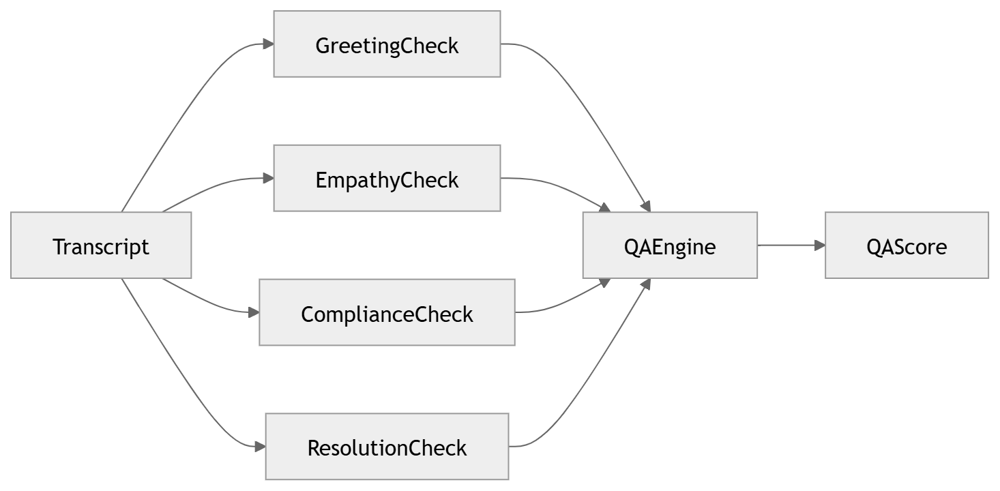

# 24 · QA Evaluation

> **Section:** [AI Pipeline](../../ai/overview.md) &nbsp;|&nbsp; **Diagram ID:** `24`

## Purpose

QA evaluation & compliance scoring.

## Description

Scores conversations against QA scorecards and compliance rules, combining deterministic checks with LLM-assisted grading.

## Diagram

## Inputs

- Conversation intelligence
- LLM outputs
- Scorecard rules

## Outputs

- QA scores
- Compliance flags

## Dependencies

- Rules engine
- LLM

## Business Value

Automates 100% call QA instead of sampling.

## Technical Notes

Entities (20) drive compliance/PII checks.

## Related Diagrams

- [20 · Named Entity Recognition](../02_AI_Pipeline/20_Named_Entity_Recognition.md)
- [22 · Conversation Intelligence](../02_AI_Pipeline/22_Conversation_Intelligence.md)
- [23 · LLM Orchestration](../02_AI_Pipeline/23_LLM_Orchestration.md)
- [27 · Coaching Recommendation](../02_AI_Pipeline/27_Coaching_Recommendation.md)

---

### Navigation

⬅ Previous: [23 · LLM Orchestration](../02_AI_Pipeline/23_LLM_Orchestration.md)  &nbsp;|&nbsp;  ⬆ [Diagram Index](../../architecture_index.md)  &nbsp;|&nbsp;  ➡ Next: [25 · Business Intelligence](../02_AI_Pipeline/25_Business_Intelligence.md)
