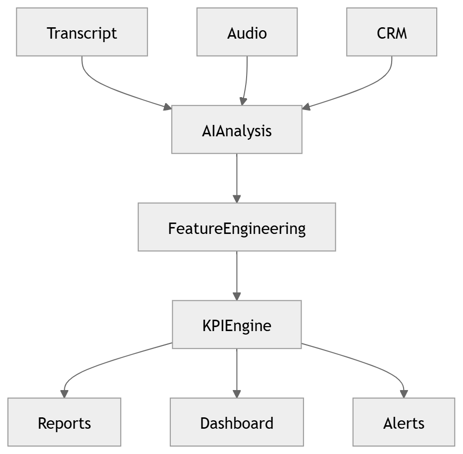

# 25 · Business Intelligence

> **Section:** [AI Pipeline](../../ai/overview.md) &nbsp;|&nbsp; **Diagram ID:** `25`

## Purpose

Business intelligence pipeline.

## Description

Transforms enriched conversations into business metrics, KPIs and trends for leadership dashboards.

## Diagram

## Inputs

- Conversation intelligence
- Aggregates

## Outputs

- KPIs
- BI datasets

## Dependencies

- Warehouse
- Aggregation

## Business Value

Connects conversation signals to business outcomes.

## Technical Notes

Reads from the analytics warehouse (39).

## Related Diagrams

- [09 · Analytics Architecture](../01_System_Overview/09_Analytics_Architecture.md)
- [19 · Topic Modeling](../02_AI_Pipeline/19_Topic_Modeling.md)
- [28 · Analytics Aggregation](../02_AI_Pipeline/28_Analytics_Aggregation.md)
- [39 · Analytics Warehouse](../03_Data_Architecture/39_Analytics_Warehouse.md)

---

### Navigation

⬅ Previous: [24 · QA Evaluation](../02_AI_Pipeline/24_QA_Evaluation.md)  &nbsp;|&nbsp;  ⬆ [Diagram Index](../../architecture_index.md)  &nbsp;|&nbsp;  ➡ Next: [26 · Prediction Engine](../02_AI_Pipeline/26_Prediction_Engine.md)
