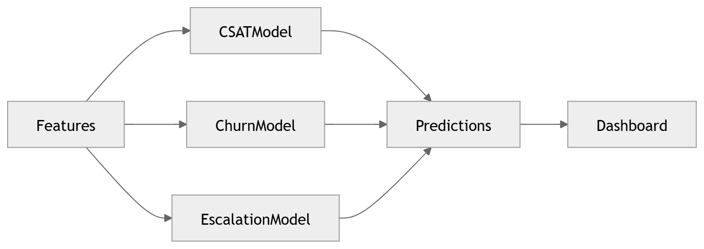

# 26 · Prediction Engine

> **Section:** [AI Pipeline](../../ai/overview.md) &nbsp;|&nbsp; **Diagram ID:** `26`

## Purpose

Prediction engine.

## Description

Predictive models for outcomes such as churn, CSAT, escalation and resolution likelihood.

## Diagram

## Inputs

- Features from feature store
- Conversation intelligence

## Outputs

- Predictions + scores

## Dependencies

- Feature store
- ML models

## Business Value

Shifts the platform from descriptive to predictive.

## Technical Notes

Consumes features served by the feature store (34).

## Related Diagrams

- [18 · Sentiment Analysis](../02_AI_Pipeline/18_Sentiment_Analysis.md)
- [29 · AI Decision Engine](../02_AI_Pipeline/29_AI_Decision_Engine.md)
- [34 · Feature Store](../03_Data_Architecture/34_Feature_Store.md)
- [27 · Coaching Recommendation](../02_AI_Pipeline/27_Coaching_Recommendation.md)

---

### Navigation

⬅ Previous: [25 · Business Intelligence](../02_AI_Pipeline/25_Business_Intelligence.md)  &nbsp;|&nbsp;  ⬆ [Diagram Index](../../architecture_index.md)  &nbsp;|&nbsp;  ➡ Next: [27 · Coaching Recommendation](../02_AI_Pipeline/27_Coaching_Recommendation.md)
