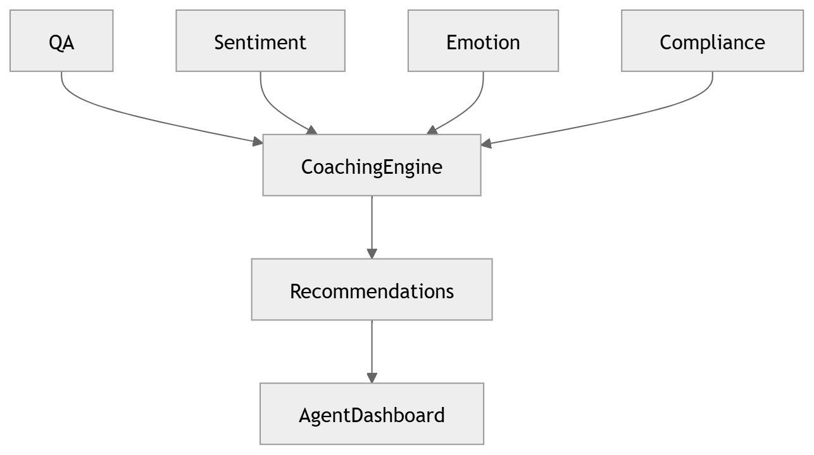

# 27 · Coaching Recommendation

> **Section:** [AI Pipeline](../../ai/overview.md) &nbsp;|&nbsp; **Diagram ID:** `27`

## Purpose

Coaching recommendation engine.

## Description

Generates targeted agent coaching from QA, sentiment and LLM analysis.

## Diagram

## Inputs

- QA scores
- LLM insights
- Predictions

## Outputs

- Coaching recommendations

## Dependencies

- QA pipeline
- LLM

## Business Value

Closes the loop from insight to agent improvement.

## Technical Notes

Surfaced in the supervisor dashboard.

## Related Diagrams

- [24 · QA Evaluation](../02_AI_Pipeline/24_QA_Evaluation.md)
- [23 · LLM Orchestration](../02_AI_Pipeline/23_LLM_Orchestration.md)
- [26 · Prediction Engine](../02_AI_Pipeline/26_Prediction_Engine.md)
- [08 · Dashboard Modules](../01_System_Overview/08_Dashboard_Modules.md)

---

### Navigation

⬅ Previous: [26 · Prediction Engine](../02_AI_Pipeline/26_Prediction_Engine.md)  &nbsp;|&nbsp;  ⬆ [Diagram Index](../../architecture_index.md)  &nbsp;|&nbsp;  ➡ Next: [28 · Analytics Aggregation](../02_AI_Pipeline/28_Analytics_Aggregation.md)
