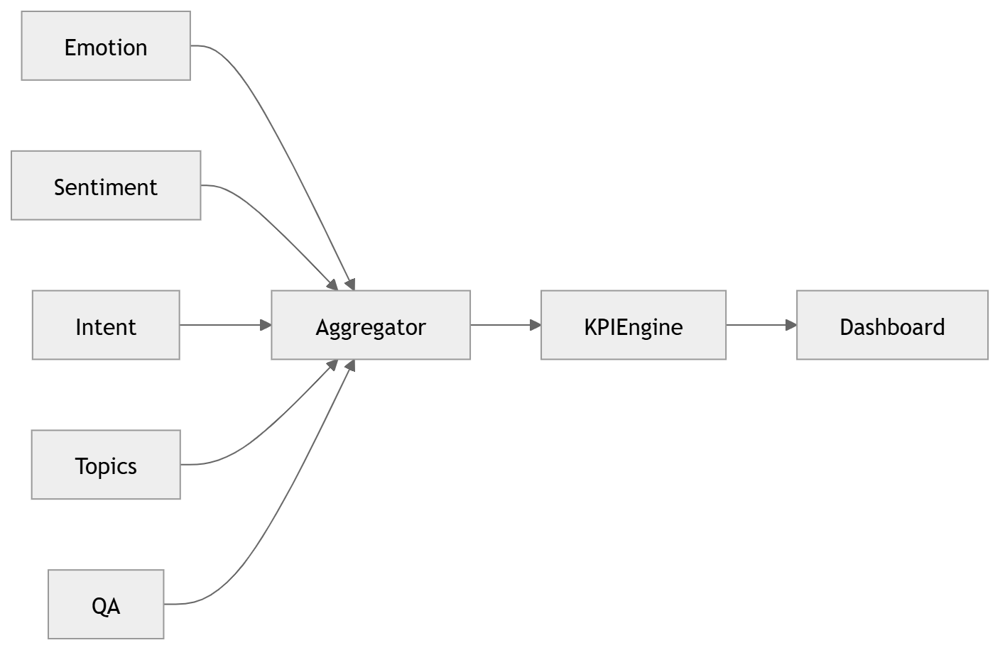

# 28 · Analytics Aggregation

> **Section:** [AI Pipeline](../../ai/overview.md) &nbsp;|&nbsp; **Diagram ID:** `28`

## Purpose

Analytics aggregation.

## Description

Rolls up per-conversation intelligence into time-windowed, dimensioned aggregates for fast dashboard queries.

## Diagram

## Inputs

- Conversation intelligence stream

## Outputs

- Aggregated metrics

## Dependencies

- Stream/batch jobs
- Warehouse

## Business Value

Sub-second dashboards over millions of calls.

## Technical Notes

Writes to the analytics warehouse (39).

## Related Diagrams

- [09 · Analytics Architecture](../01_System_Overview/09_Analytics_Architecture.md)
- [25 · Business Intelligence](../02_AI_Pipeline/25_Business_Intelligence.md)
- [39 · Analytics Warehouse](../03_Data_Architecture/39_Analytics_Warehouse.md)
- [44 · Dashboard Request](../04_Backend/44_Dashboard_Request.md)

---

### Navigation

⬅ Previous: [27 · Coaching Recommendation](../02_AI_Pipeline/27_Coaching_Recommendation.md)  &nbsp;|&nbsp;  ⬆ [Diagram Index](../../architecture_index.md)  &nbsp;|&nbsp;  ➡ Next: [29 · AI Decision Engine](../02_AI_Pipeline/29_AI_Decision_Engine.md)
