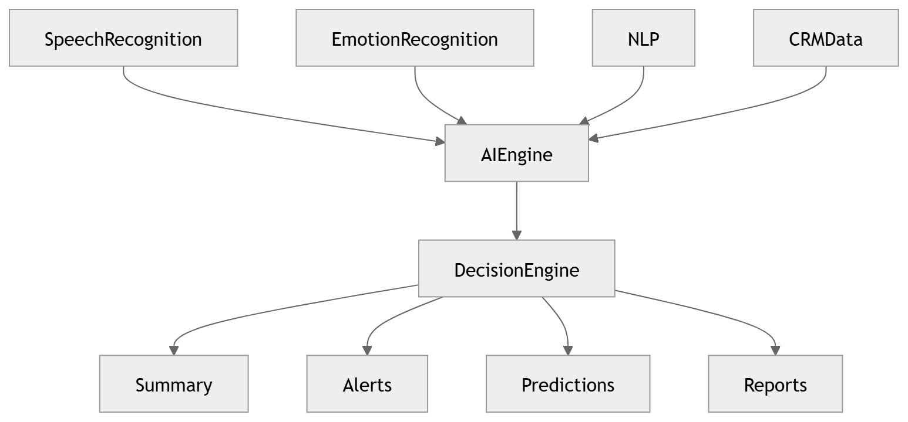

# 29 · AI Decision Engine

> **Section:** [AI Pipeline](../../ai/overview.md) &nbsp;|&nbsp; **Diagram ID:** `29`

## Purpose

AI decision engine.

## Description

Combines predictions, QA, compliance and rules into automated decisions and next-best-actions.

## Diagram

## Inputs

- Predictions
- QA/compliance
- Rules

## Outputs

- Decisions / actions / alerts

## Dependencies

- Rules engine
- Prediction engine
- LLM

## Business Value

Operationalizes intelligence into automated action.

## Technical Notes

Terminal reasoning node of the AI pipeline.

## Related Diagrams

- [26 · Prediction Engine](../02_AI_Pipeline/26_Prediction_Engine.md)
- [24 · QA Evaluation](../02_AI_Pipeline/24_QA_Evaluation.md)
- [23 · LLM Orchestration](../02_AI_Pipeline/23_LLM_Orchestration.md)
- [30 · Complete AI Pipeline](../02_AI_Pipeline/30_Complete_AI_Pipeline.md)

---

### Navigation

⬅ Previous: [28 · Analytics Aggregation](../02_AI_Pipeline/28_Analytics_Aggregation.md)  &nbsp;|&nbsp;  ⬆ [Diagram Index](../../architecture_index.md)  &nbsp;|&nbsp;  ➡ Next: [30 · Complete AI Pipeline](../02_AI_Pipeline/30_Complete_AI_Pipeline.md)
