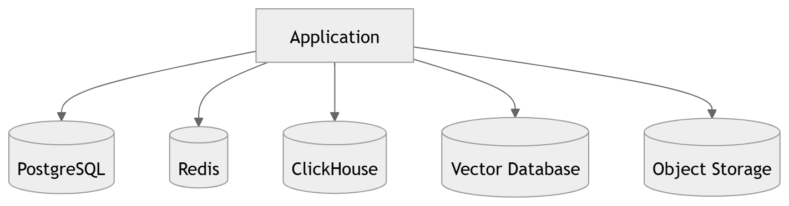

# 31 · Database Architecture

> **Section:** [Data Architecture](../../database/overview.md) &nbsp;|&nbsp; **Diagram ID:** `31`

## Purpose

Database architecture overview.

## Description

The full storage topology: operational DBs, warehouse, vector DB, feature store, object store, cache and metadata store.

## Diagram

## Inputs

- Writes from services

## Outputs

- Durable, queryable data

## Dependencies

- All datastores

## Business Value

One map of every place data lives and why.

## Technical Notes

Parent of diagrams 32-40.

## Related Diagrams

- [32 · ER Diagram](../03_Data_Architecture/32_ER_Diagram.md)
- [34 · Feature Store](../03_Data_Architecture/34_Feature_Store.md)
- [35 · Vector Search](../03_Data_Architecture/35_Vector_Search.md)
- [39 · Analytics Warehouse](../03_Data_Architecture/39_Analytics_Warehouse.md)
- [38 · Cache Architecture](../03_Data_Architecture/38_Cache_Architecture.md)

---

### Navigation

⬅ Previous: [30 · Complete AI Pipeline](../02_AI_Pipeline/30_Complete_AI_Pipeline.md)  &nbsp;|&nbsp;  ⬆ [Diagram Index](../../architecture_index.md)  &nbsp;|&nbsp;  ➡ Next: [32 · ER Diagram](../03_Data_Architecture/32_ER_Diagram.md)
