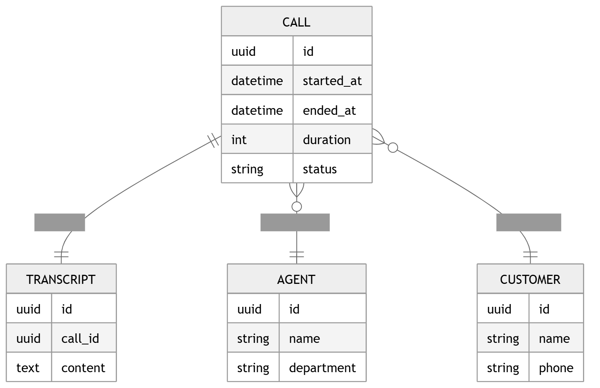

# 32 · ER Diagram

> **Section:** [Data Architecture](../../database/overview.md) &nbsp;|&nbsp; **Diagram ID:** `32`

## Purpose

Operational entity-relationship model.

## Description

ER model for the core OLTP schema (calls, agents, customers, evaluations, etc.).

## Diagram

## Inputs

- Schema definition

## Outputs

- Relational model

## Dependencies

- Relational DB

## Business Value

Canonical reference for service developers.

## Technical Notes

Analytics modelling lives in the analytics ERD (33).

## Related Diagrams

- [31 · Database Architecture](../03_Data_Architecture/31_Database_Architecture.md)
- [33 · Analytics ERD](../03_Data_Architecture/33_Analytics_ERD.md)
- [37 · Metadata Storage](../03_Data_Architecture/37_Metadata_Storage.md)

---

### Navigation

⬅ Previous: [31 · Database Architecture](../03_Data_Architecture/31_Database_Architecture.md)  &nbsp;|&nbsp;  ⬆ [Diagram Index](../../architecture_index.md)  &nbsp;|&nbsp;  ➡ Next: [33 · Analytics ERD](../03_Data_Architecture/33_Analytics_ERD.md)
