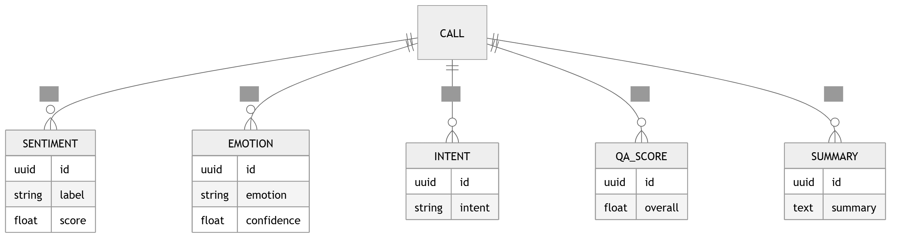

# 33 · Analytics ERD

> **Section:** [Data Architecture](../../database/overview.md) &nbsp;|&nbsp; **Diagram ID:** `33`

## Purpose

Analytics / warehouse data model.

## Description

Dimensional (star/snowflake) model powering BI and aggregation.

## Diagram

## Inputs

- Conformed dimensions/facts

## Outputs

- Analytical schema

## Dependencies

- Warehouse

## Business Value

Optimized for slice-and-dice analytics.

## Technical Notes

Populated by analytics aggregation (28).

## Related Diagrams

- [32 · ER Diagram](../03_Data_Architecture/32_ER_Diagram.md)
- [39 · Analytics Warehouse](../03_Data_Architecture/39_Analytics_Warehouse.md)
- [28 · Analytics Aggregation](../02_AI_Pipeline/28_Analytics_Aggregation.md)
- [25 · Business Intelligence](../02_AI_Pipeline/25_Business_Intelligence.md)

---

### Navigation

⬅ Previous: [32 · ER Diagram](../03_Data_Architecture/32_ER_Diagram.md)  &nbsp;|&nbsp;  ⬆ [Diagram Index](../../architecture_index.md)  &nbsp;|&nbsp;  ➡ Next: [34 · Feature Store](../03_Data_Architecture/34_Feature_Store.md)
