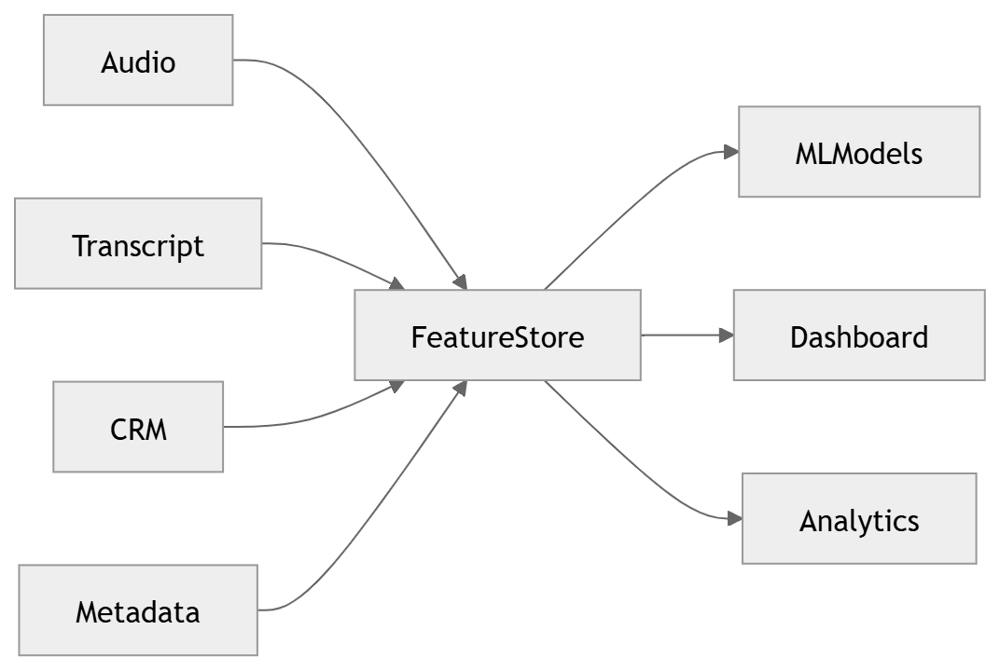

# 34 · Feature Store

> **Section:** [Data Architecture](../../database/overview.md) &nbsp;|&nbsp; **Diagram ID:** `34`

## Purpose

Feature store architecture.

## Description

Online/offline feature store providing consistent features to training and low-latency inference.

## Diagram

## Inputs

- Engineered features

## Outputs

- Served features

## Dependencies

- Online store
- Offline store

## Business Value

Eliminates training/serving skew.

## Technical Notes

Serves the prediction engine (26).

## Related Diagrams

- [26 · Prediction Engine](../02_AI_Pipeline/26_Prediction_Engine.md)
- [07 · AI Service Architecture](../01_System_Overview/07_AI_Service_Architecture.md)
- [31 · Database Architecture](../03_Data_Architecture/31_Database_Architecture.md)
- [35 · Vector Search](../03_Data_Architecture/35_Vector_Search.md)

---

### Navigation

⬅ Previous: [33 · Analytics ERD](../03_Data_Architecture/33_Analytics_ERD.md)  &nbsp;|&nbsp;  ⬆ [Diagram Index](../../architecture_index.md)  &nbsp;|&nbsp;  ➡ Next: [35 · Vector Search](../03_Data_Architecture/35_Vector_Search.md)
