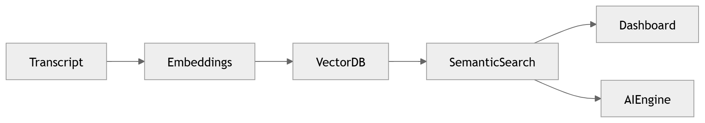

# 35 · Vector Search

> **Section:** [Data Architecture](../../database/overview.md) &nbsp;|&nbsp; **Diagram ID:** `35`

## Purpose

Vector search architecture.

## Description

Embedding generation, indexing and similarity search powering RAG and semantic retrieval.

## Diagram

## Inputs

- Embeddings

## Outputs

- Nearest-neighbour results

## Dependencies

- Vector DB
- Embedding models

## Business Value

Enables semantic search and grounded LLM responses.

## Technical Notes

Consumed by LLM orchestration (23).

## Related Diagrams

- [23 · LLM Orchestration](../02_AI_Pipeline/23_LLM_Orchestration.md)
- [21 · Keyword Extraction](../02_AI_Pipeline/21_Keyword_Extraction.md)
- [31 · Database Architecture](../03_Data_Architecture/31_Database_Architecture.md)
- [34 · Feature Store](../03_Data_Architecture/34_Feature_Store.md)

---

### Navigation

⬅ Previous: [34 · Feature Store](../03_Data_Architecture/34_Feature_Store.md)  &nbsp;|&nbsp;  ⬆ [Diagram Index](../../architecture_index.md)  &nbsp;|&nbsp;  ➡ Next: [36 · Object Storage](../03_Data_Architecture/36_Object_Storage.md)
