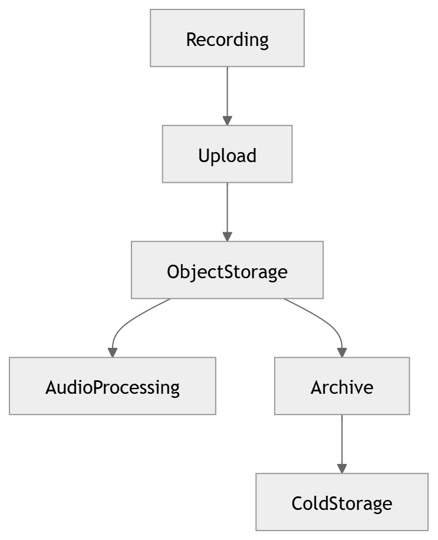

# 36 · Object Storage

> **Section:** [Data Architecture](../../database/overview.md) &nbsp;|&nbsp; **Diagram ID:** `36`

## Purpose

Object storage architecture.

## Description

Durable storage for raw audio, transcripts and large artifacts with tiering and lifecycle rules.

## Diagram

## Inputs

- Audio files
- Artifacts

## Outputs

- Durable object store

## Dependencies

- Object storage / blob

## Business Value

Cost-efficient durable home for large media.

## Technical Notes

Retention governed by the data lifecycle (40).

## Related Diagrams

- [31 · Database Architecture](../03_Data_Architecture/31_Database_Architecture.md)
- [40 · Data Lifecycle](../03_Data_Architecture/40_Data_Lifecycle.md)
- [37 · Metadata Storage](../03_Data_Architecture/37_Metadata_Storage.md)
- [12 · Audio Processing](../02_AI_Pipeline/12_Audio_Processing.md)

---

### Navigation

⬅ Previous: [35 · Vector Search](../03_Data_Architecture/35_Vector_Search.md)  &nbsp;|&nbsp;  ⬆ [Diagram Index](../../architecture_index.md)  &nbsp;|&nbsp;  ➡ Next: [37 · Metadata Storage](../03_Data_Architecture/37_Metadata_Storage.md)
