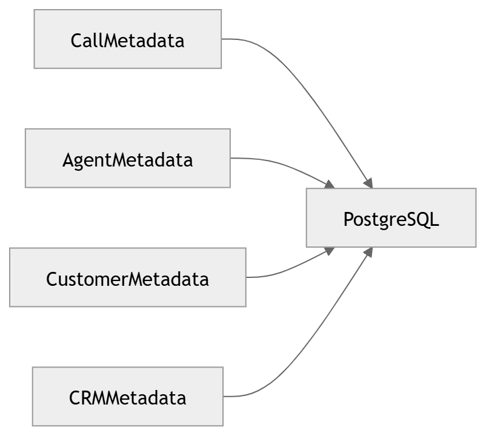

# 37 · Metadata Storage

> **Section:** [Data Architecture](../../database/overview.md) &nbsp;|&nbsp; **Diagram ID:** `37`

## Purpose

Metadata storage.

## Description

Catalog/metadata store tracking lineage, schemas and processing state.

## Diagram

## Inputs

- Processing metadata

## Outputs

- Queryable metadata catalog

## Dependencies

- Metadata DB

## Business Value

Enables lineage, discovery and governance.

## Technical Notes

Cross-references object (36) and relational (32) stores.

## Related Diagrams

- [31 · Database Architecture](../03_Data_Architecture/31_Database_Architecture.md)
- [32 · ER Diagram](../03_Data_Architecture/32_ER_Diagram.md)
- [36 · Object Storage](../03_Data_Architecture/36_Object_Storage.md)
- [40 · Data Lifecycle](../03_Data_Architecture/40_Data_Lifecycle.md)

---

### Navigation

⬅ Previous: [36 · Object Storage](../03_Data_Architecture/36_Object_Storage.md)  &nbsp;|&nbsp;  ⬆ [Diagram Index](../../architecture_index.md)  &nbsp;|&nbsp;  ➡ Next: [38 · Cache Architecture](../03_Data_Architecture/38_Cache_Architecture.md)
