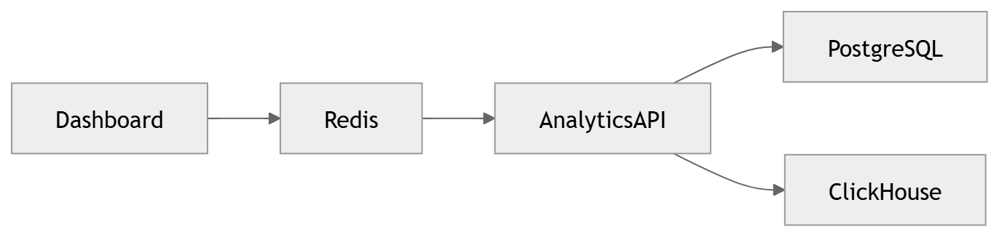

# 38 · Cache Architecture

> **Section:** [Data Architecture](../../database/overview.md) &nbsp;|&nbsp; **Diagram ID:** `38`

## Purpose

Cache architecture.

## Description

In-memory caching strategy (read-through, write-through, TTLs) for hot data and dashboards.

## Diagram

## Inputs

- Hot keys/queries

## Outputs

- Low-latency reads

## Dependencies

- Distributed cache

## Business Value

Protects datastores and keeps dashboards fast.

## Technical Notes

Fronts dashboard requests (44).

## Related Diagrams

- [31 · Database Architecture](../03_Data_Architecture/31_Database_Architecture.md)
- [44 · Dashboard Request](../04_Backend/44_Dashboard_Request.md)
- [39 · Analytics Warehouse](../03_Data_Architecture/39_Analytics_Warehouse.md)

---

### Navigation

⬅ Previous: [37 · Metadata Storage](../03_Data_Architecture/37_Metadata_Storage.md)  &nbsp;|&nbsp;  ⬆ [Diagram Index](../../architecture_index.md)  &nbsp;|&nbsp;  ➡ Next: [39 · Analytics Warehouse](../03_Data_Architecture/39_Analytics_Warehouse.md)
