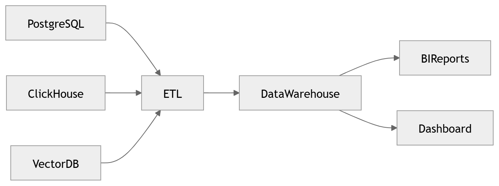

# 39 · Analytics Warehouse

> **Section:** [Data Architecture](../../database/overview.md) &nbsp;|&nbsp; **Diagram ID:** `39`

## Purpose

Analytics warehouse.

## Description

Columnar warehouse serving BI, aggregation and ad-hoc analytics.

## Diagram

## Inputs

- Aggregated/conformed data

## Outputs

- Analytical query results

## Dependencies

- Warehouse engine

## Business Value

Scales analytics independently of OLTP.

## Technical Notes

Loaded by analytics aggregation (28); modelled by (33).

## Related Diagrams

- [28 · Analytics Aggregation](../02_AI_Pipeline/28_Analytics_Aggregation.md)
- [33 · Analytics ERD](../03_Data_Architecture/33_Analytics_ERD.md)
- [25 · Business Intelligence](../02_AI_Pipeline/25_Business_Intelligence.md)
- [09 · Analytics Architecture](../01_System_Overview/09_Analytics_Architecture.md)

---

### Navigation

⬅ Previous: [38 · Cache Architecture](../03_Data_Architecture/38_Cache_Architecture.md)  &nbsp;|&nbsp;  ⬆ [Diagram Index](../../architecture_index.md)  &nbsp;|&nbsp;  ➡ Next: [40 · Data Lifecycle](../03_Data_Architecture/40_Data_Lifecycle.md)
