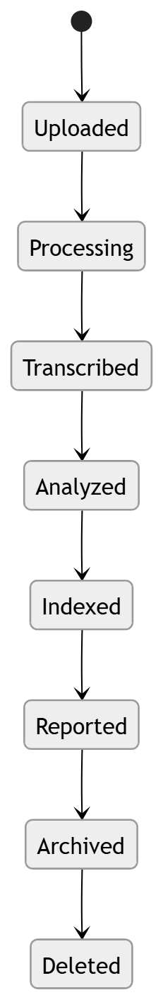

# 40 · Data Lifecycle

> **Section:** [Data Architecture](../../database/overview.md) &nbsp;|&nbsp; **Diagram ID:** `40`

## Purpose

Data lifecycle & retention.

## Description

Lifecycle states from ingestion through archival and deletion, with retention, redaction and compliance rules.

## Diagram

## Inputs

- All stored data

## Outputs

- Retention/redaction actions

## Dependencies

- Lifecycle policies
- Storage tiers

## Business Value

Keeps the platform compliant and cost-controlled.

## Technical Notes

Applies across object (36) and metadata (37) stores.

## Related Diagrams

- [36 · Object Storage](../03_Data_Architecture/36_Object_Storage.md)
- [37 · Metadata Storage](../03_Data_Architecture/37_Metadata_Storage.md)
- [31 · Database Architecture](../03_Data_Architecture/31_Database_Architecture.md)
- [10 · Overall Data Flow](../01_System_Overview/10_Overall_Data_Flow.md)

---

### Navigation

⬅ Previous: [39 · Analytics Warehouse](../03_Data_Architecture/39_Analytics_Warehouse.md)  &nbsp;|&nbsp;  ⬆ [Diagram Index](../../architecture_index.md)  &nbsp;|&nbsp;  ➡ Next: [41 · API Gateway](../04_Backend/41_API_Gateway.md)
