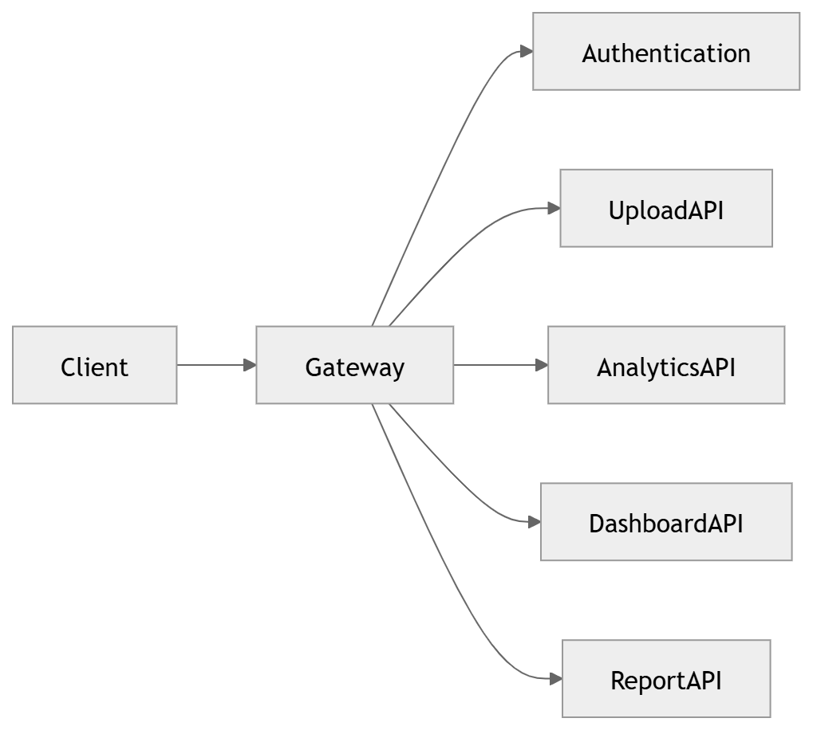

# 41 · API Gateway

> **Section:** [Backend & API](../../backend/overview.md) &nbsp;|&nbsp; **Diagram ID:** `41`

## Purpose

API gateway architecture.

## Description

Single entry point handling routing, auth, rate-limiting, TLS and observability for all external traffic.

## Diagram

## Inputs

- Client requests

## Outputs

- Routed, authenticated requests

## Dependencies

- Gateway
- Identity provider

## Business Value

Centralizes cross-cutting concerns at the edge.

## Technical Notes

Enforces authentication (48) and RBAC (49).

## Related Diagrams

- [03 · Container Diagram](../01_System_Overview/03_Container_Diagram.md)
- [42 · Upload API](../04_Backend/42_Upload_API.md)
- [48 · Authentication](../04_Backend/48_Authentication.md)
- [49 · RBAC](../04_Backend/49_RBAC.md)
- [50 · Backend Overview](../04_Backend/50_Backend_Overview.md)

---

### Navigation

⬅ Previous: [40 · Data Lifecycle](../03_Data_Architecture/40_Data_Lifecycle.md)  &nbsp;|&nbsp;  ⬆ [Diagram Index](../../architecture_index.md)  &nbsp;|&nbsp;  ➡ Next: [42 · Upload API](../04_Backend/42_Upload_API.md)
