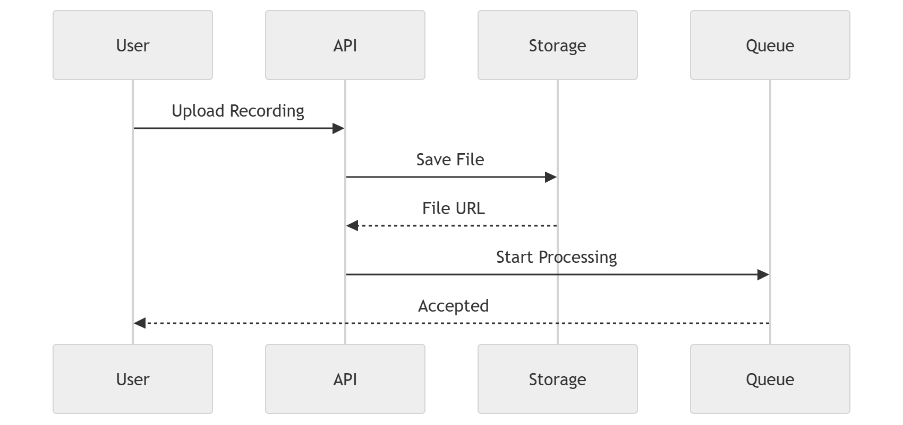

# 42 · Upload API

> **Section:** [Backend & API](../../backend/overview.md) &nbsp;|&nbsp; **Diagram ID:** `42`

## Purpose

Upload API & ingestion.

## Description

Endpoint and flow for submitting audio/metadata, including validation, virus/format checks and hand-off to processing.

## Diagram

## Inputs

- Audio uploads + metadata

## Outputs

- Accepted jobs
- Storage writes

## Dependencies

- API gateway
- Object storage
- Queue

## Business Value

Reliable, validated entry of source material.

## Technical Notes

Triggers the processing sequence (43).

## Related Diagrams

- [41 · API Gateway](../04_Backend/41_API_Gateway.md)
- [43 · Processing Sequence](../04_Backend/43_Processing_Sequence.md)
- [36 · Object Storage](../03_Data_Architecture/36_Object_Storage.md)
- [06 · Call Processing Overview](../01_System_Overview/06_Call_Processing_Overview.md)

---

### Navigation

⬅ Previous: [41 · API Gateway](../04_Backend/41_API_Gateway.md)  &nbsp;|&nbsp;  ⬆ [Diagram Index](../../architecture_index.md)  &nbsp;|&nbsp;  ➡ Next: [43 · Processing Sequence](../04_Backend/43_Processing_Sequence.md)
