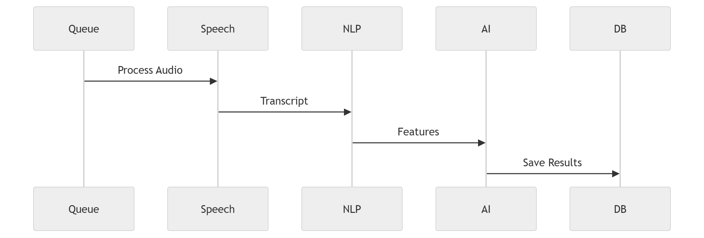

# 43 · Processing Sequence

> **Section:** [Backend & API](../../backend/overview.md) &nbsp;|&nbsp; **Diagram ID:** `43`

## Purpose

Processing sequence (timing).

## Description

Sequence diagram of an upload moving through queue, AI workers and persistence, including async callbacks.

## Diagram

## Inputs

- Accepted job

## Outputs

- Persisted enriched record

## Dependencies

- Queue
- AI workers
- Datastores

## Business Value

The authoritative request-timing reference.

## Technical Notes

Realizes call processing overview (6) at sequence detail.

## Related Diagrams

- [06 · Call Processing Overview](../01_System_Overview/06_Call_Processing_Overview.md)
- [42 · Upload API](../04_Backend/42_Upload_API.md)
- [46 · Event Driven Backend](../04_Backend/46_Event_Driven_Backend.md)
- [11 · End to End AI Pipeline](../02_AI_Pipeline/11_End_to_End_AI_Pipeline.md)

---

### Navigation

⬅ Previous: [42 · Upload API](../04_Backend/42_Upload_API.md)  &nbsp;|&nbsp;  ⬆ [Diagram Index](../../architecture_index.md)  &nbsp;|&nbsp;  ➡ Next: [44 · Dashboard Request](../04_Backend/44_Dashboard_Request.md)
